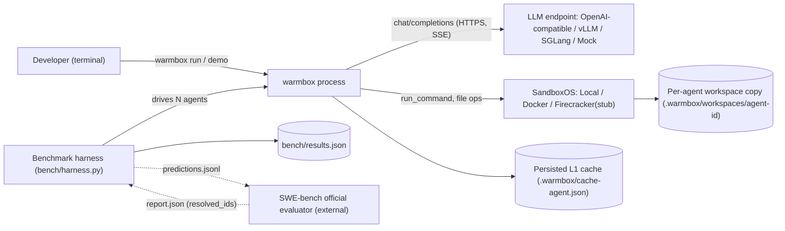
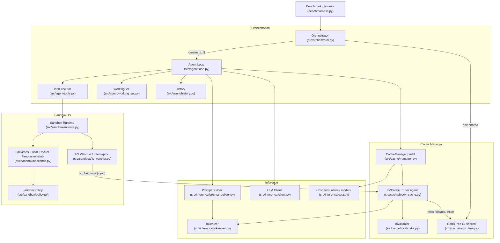
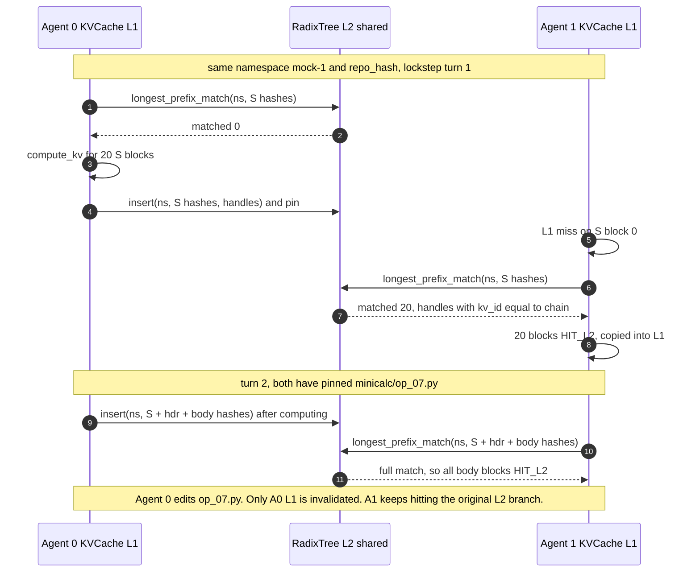

# warmbox — design document

**Design document (HLD + LLD)** · v1.0

This document specifies the block cache, the prompt layout, the sandbox and the benchmark. Section
numbers (§) are stable and are cited from source comments.

Two reading conventions: the package directory is `warmbox/`, so where a section below writes
`src/…` read `warmbox/…`; and anything marked **SIMULATED** is implemented as a simulation on
purpose, with the real mechanism deferred to the Phase 4 notes in §10.

## Implementation notes

Three places where the specification contradicted itself, and what the code does:

1. **`RadixTree.insert` with a parent prefix.** §4.1 and §4.3 pass the whole path (`S + hdr + body`
   hashes) while supplying only the body handles. Under the equal-length contract of §3.6 that
   raises `ValueError` on every file segment. The implementation accepts a shorter handle list,
   reusing the stored handles for the leading prefix, and treats an absent prefix as a skipped
   insert: L2 is an optimisation, and every hit is still verified against the chain hash, so a
   skipped insert costs a recompute and never correctness.
2. **`KVCache` construction.** §3.5 declares keyword-only arguments; §3.22 calls it positionally.
   The §3.5 signature is kept and the call site was corrected.
3. **Parallel-agent reuse test.** §9.2 asserts that followers reuse exactly the stable segment.
   That holds only when agent goals differ; with identical goals the history segment is shared as
   well, which §4.3 states. The test uses distinct goals.

Additive choices, each marked `# DESIGN-GAP:` in the source where it appears:
`ToolExecutor.turn`, `Orchestrator.policy`, `Orchestrator.keep_workspaces`,
`AgentSpec.temperature`.

---

## 0. Conventions, glossary, constants

### 0.1 Glossary

| Term | Meaning |
|---|---|
| **Token** | A unit produced by the simulated tokenizer (§3.12). It is lossless, so `"".join(tokenize(s)) == s`. |
| **Block** | Up to `BLOCK_SIZE = 128` consecutive tokens of one segment. Only the final block of a segment can be partial. |
| **Chunk** | The text of one block, made by joining its tokens. |
| **Content hash** | `chunk_hash(chunk_text)`: 128-bit BLAKE3, or BLAKE2b-128 when BLAKE3 is unavailable, as 32 lowercase hex characters. |
| **Chain hash** | `chain_hash(parent_chain, content_hash)`. It identifies a block **together with everything before it**. It is also the block's `kv_id`. |
| **BlockKey** | `(file_path, file_version, block_index, content_hash)`, the key for the per-agent L1 index. |
| **Segment** | A contiguous region of the prompt that has its own cache key: the stable prefix, the history, one file header or one file body. |
| **Pseudo-file** | A segment that is not a workspace file. Its key starts with `<`: `<stable>`, `<history>`, `<hdr>:{path}`. |
| **S / H / F** | Stable prefix / append-only History / working-set Files. The prompt order is always **S → H → F**. |
| **L1** | `KVCache`. There is one per agent. It is indexed by `BlockKey`, uses LRU eviction and holds at most 10,000 blocks. |
| **L2** | `RadixTree`. There is one per process and every agent shares it. It is indexed by the sequence of content hashes under a namespace. |
| **Namespace** | `f"{model_id}|{repo_hash}"`. KV is shared only inside a namespace. |
| **Prefill tokens** | All prompt tokens accounted in a turn, so `reused + recompute`. |
| **Reused tokens** | Tokens whose KV came from L1 or L2. `CacheStats.tokens_saved` is the same thing. |
| **Recompute tokens** | Tokens whose KV had to be computed this turn (`compute_kv`). |
| **Modular segment** | A file segment whose KV attends only to `S + its own header + its own earlier blocks`, and not to H or to other files. See §2.1 D2. |

### 0.2 Constants (`src/config.py`, all module-level)

```python
BLOCK_SIZE: int = 128
L1_MAX_BLOCKS: int = 10_000
L2_MAX_BLOCKS: int = 10_000
HASH_DIGEST_BYTES: int = 16                  # 128-bit -> 32 hex chars
STABLE_KEY: str = "<stable>"
HISTORY_KEY: str = "<history>"
HEADER_KEY_PREFIX: str = "<hdr>:"            # header pseudo-file key = "<hdr>:" + path
WORKING_SET_MAX_FILES: int = 12
WORKING_SET_MAX_TOKENS: int = 24_000
MAX_TOOL_OUTPUT_CHARS: int = 4_000
MAX_FILE_BYTES: int = 1_048_576              # 1 MiB
DEFAULT_CMD_TIMEOUT_S: float = 60.0
MAX_CMD_TIMEOUT_S: float = 120.0
MAX_CMD_OUTPUT_BYTES: int = 65_536
MAX_TURNS: int = 30
REPO_MAP_MAX_FILES: int = 500
REPO_MAP_MAX_TOKENS: int = 4_000
SEARCH_MAX_MATCHES: int = 50
# Latency model (SIMULATED TTFT). Assumes ~10k tok/s prefill and cheap cached-block loads.
LATENCY_OVERHEAD_MS: float = 50.0
PREFILL_MS_PER_TOKEN: float = 0.10
CACHED_MS_PER_TOKEN: float = 0.002
# Cost model, USD per 1M tokens. PLACEHOLDERS: override via env (§0.3).
PRICE_INPUT_PER_MTOK: float = 3.00
PRICE_CACHED_PER_MTOK: float = 0.30
PRICE_OUTPUT_PER_MTOK: float = 15.00
HOME_DIR: str = ".warmbox"                 # relative to CWD
```

### 0.3 Environment variables (`src/config.py: Settings.from_env()`)

| Var | Default | Used by |
|---|---|---|
| `WARMBOX_BACKEND` | `mock` | `make_client` |
| `WARMBOX_BASE_URL` | `http://localhost:8000/v1` | OpenAI-compatible backend |
| `WARMBOX_API_KEY` | `""` | OpenAI-compatible backend. It is **never** passed into the sandbox. |
| `WARMBOX_MODEL` | `mock-1` | client, namespace |
| `WARMBOX_PRICE_INPUT` / `_CACHED` / `_OUTPUT` | constants above | `CostModel` |
| `WARMBOX_HOME` | `.warmbox` | workspaces, persisted cache |

```python
@dataclass(frozen=True, slots=True)
class Settings:
    backend: str
    base_url: str
    api_key: str
    model: str
    price_input: float
    price_cached: float
    price_output: float
    home: Path
    @classmethod
    def from_env(cls, env: Mapping[str, str] | None = None) -> "Settings": ...
```

---

## 1. Executive summary, goals, non-goals, success metrics

### 1.1 Executive summary

warmbox is an OpenCode-style terminal coding agent built around **prefill reuse**. Today's agents send a prompt every turn that is mostly identical to the previous one: the system prompt, tool schemas, repository context, the conversation so far and file contents. Without a cache, the engine recomputes all of it. warmbox avoids that with four parts:

1. **Content-addressed KV blocks.** Every segment is cut into 128-token blocks keyed by `(file_path, file_version, block_index, content_hash)` and verified by a chain hash.
2. **Prompt layout for cacheability.** The order is a permanent stable prefix (S), then append-only history (H), then the live working-set files (F). File contents never sit inside history. History holds short references, and the files are re-rendered at the end of every prompt.
3. **Write-time invalidation.** Every file write goes through the sandbox FS layer. Before the next LLM call, that layer bumps the file version, finds the first divergent block and drops only the blocks from that point on.
4. **A shared radix tree (L2).** N agents working on the same repo snapshot reuse each other's KV blocks for S and for unchanged files.

All of this runs inside **SandboxOS**: a workspace jail with a command allowlist and no network by default. A Docker backend is provided, and Firecracker is designed for but stubbed.

The MVP is pure Python 3.12 stdlib and runs without a GPU. The KV tensors are **SIMULATED** as handles, so cache behaviour, accounting, invalidation correctness and sandboxing are real, while prefill compute and TTFT come from a model (§11.1).

### 1.2 Goals

| # | Goal |
|---|---|
| G1 | Stable-prefix KV is computed once per namespace and reused on every turn by every agent. |
| G2 | A file edit invalidates only the blocks from the first divergent block of that file onwards. |
| G3 | **A stale block can never be returned.** A cache can only be correct or miss (property-tested, §9). |
| G4 | Parallel agents on the same repo share KV through L2 (cross-agent hits are measured). |
| G5 | Agents execute commands only inside a sandbox with a workspace-only filesystem view, a command allowlist and network off by default. |
| G6 | A benchmark harness reports prefix hit rate, prefill tokens saved, TTFT p50/p95, $ per task and pass@1 for baselines A, B and C into `bench/results.json`. |
| G7 | Phase 1 is a small, self-contained MVP; phases 1–3 are meant to be buildable in one sitting. |

### 1.3 Non-goals (MVP)

- Real GPU KV tensors, attention kernels, or a custom inference engine. These come in Phase 4 (SGLang).
- Real Firecracker microVMs or eBPF/seccomp syscall filtering. These come in Phase 4; MVP ships interfaces and a stub.
- A TUI. The CLI is plain argparse plus stdout.
- Exact tokenizer parity with any model. The tokenizer is a regex approximation (§11.1).
- Automated SWE-bench evaluation inside this repo. The harness emits predictions and ingests the official evaluator's report (§7.6).
- Multi-tenant L2. There is one namespace per model and repo snapshot, and there is no tenant isolation in the MVP (§8.6).

### 1.4 Success metrics (targets to **measure**, not guarantees)

| Metric | Definition (exact formula in §7.4) | Target |
|---|---|---|
| Prefill reuse on repeat turns | `Σ reused_tokens / Σ prefill_tokens` over turns ≥ 2 | **65–75%** (real engine, Phase 4); ≥ 65% gate in simulation |
| Edit recompute | Recompute tokens of edited files ÷ prefill tokens, on the turn after an edit (median) | **< 10%** |
| TTFT p50 / p95 | Nearest-rank percentiles over all turns (ms) | tracked; B and C should beat A |
| $ per task | Σ turn cost over all agents of a task (§3.13 cost model) | tracked; B < A |
| pass@1 | Fraction of tasks whose agent 0 passes the check | tracked; must not regress vs A |
| Cross-agent reuse (C) | `Σ l2_reused_tokens / Σ prefill_tokens` | > 0, reported |

---

## 2. High-Level Design

### 2.1 Design decisions and how they are made correct

These are the fixed decisions from the brief, together with the mechanisms this design uses to make each one correct. The implementing model must keep every invariant **I1–I7**.

**D1 — Blocks are content-addressed, and validity is chained.** In a causal transformer, the KV of block *i* depends on every token before it, not only on its own chunk. The `BlockKey` stays exactly `(file_path, file_version, block_index, content_hash)` as mandated. In addition, each `CachedBlock` stores `chain_hash = H(parent_chain ":" content_hash)`, and its `kv_id` equals this chain hash. A lookup counts as a hit only if **the key matches and the stored chain hash equals the chain hash recomputed from the current content and current parent context**.
- **I1 (stale-never-hits):** `hit ⇒ stored.chain_hash == expected_chain`. With a 128-bit collision-resistant hash, this means the stored KV was computed from a byte-identical token prefix. The worst case is a miss.

**D2 — Files go last, history is append-only, so file segments are modular.** Under strict causal attention, putting files after a history that grows every turn would invalidate all file KV every turn. To keep both mandated decisions (volatile file content last, and append-only history), file segments use **modular attention**, the Prompt Cache approach (Gim et al., MLSys 2024). Each file body's KV attends only to `S + its own header + its own earlier blocks`. The parent context of a file is therefore `S → header(path)` and never H. History is a plain causal continuation of S. The final generation attends to everything.
- In the MVP this is **SIMULATED** accounting. With a real OpenAI-compatible server, the server only gives exact-prefix reuse, which covers S + H (§11.1).
- **I2 (no volatile parent):** no segment that serves as a parent (S, or a file header) may contain anything that changes during a session. File headers contain the path and **never** the version.

**D3 — The stable prefix is permanent.** S is the system prompt, the canonical tool-schema JSON and a repo map snapshotted at session start. S never changes within a session. Its blocks are **pinned** in L1 and L2 and are never evicted.
- **I3:** S's text is byte-identical on every turn of a session and for every agent of the same task.

**D4 — History is append-only.** `History` exposes `append()` only. Rendering message *i* depends only on message *i*.
- **I4:** `render(history[:n])` is a prefix of `render(history[:n+k])`. Only the last partial block of H can change between turns.

**D5 — Invalidation happens at write time, before the next LLM call.** All tool writes go through `FSWatcher.intercept_write`. Out-of-band writes, for example a command that rewrites a file, are caught by `Sandbox.sync()` (`FSWatcher.rescan()`), which runs at the start of every turn before the prompt is built. Each event calls `KVCache.on_file_write`. That call bumps the version, finds the first divergent block *d*, **re-keys blocks `0..d-1` to the new version** (their chain hashes are unchanged, so they remain valid) and drops blocks `≥ d`.
- **I5:** after `sync()` returns, no L1 key for a tracked file refers to an older version.
- **I6:** even if a write bypasses both paths, I1 still prevents a stale hit. `get_blocks` detects the content change (`bypass_writes += 1`) and repairs the index.

**D6 — Shared prefix cache.** There is one process-global `RadixTree` (L2). Its root is keyed by namespace `"{model_id}|{repo_hash}"`, and its edges are sequences of content hashes. A file body's path in the tree is `S-hashes ++ header-hashes ++ body-hashes`, so the key is effectively repo_hash plus file hashes. L2 is **immutable content**: one agent's write never invalidates L2, because other agents may still be on the old content. L2 entries only age out through LRU.
- **I7:** L2 handles verify too: `handle.kv_id == expected_chain`, otherwise the lookup is treated as a miss.

**D7 — Sandbox.** The runtime is pluggable: `LocalProcessBackend` (MVP), `DockerBackend` (enforced isolation) and `FirecrackerBackend` (a stub that raises `NotImplementedError("Phase 4")`).

**D8 — Inference.** `LLMClient` is a protocol with two backends: `MockBackend`, which is scripted and deterministic, and `OpenAICompatBackend`, which uses stdlib `urllib`, SSE streaming and tool calls. The in-process `CacheManager` does all KV accounting.

### 2.2 System context



### 2.3 Components



### 2.4 End-to-end data flow for one agent turn

| Step | Component → call | Output, effect |
|---|---|---|
| 1 | `Orchestrator` calls `AgentLoop.step()` | Turn `t` begins. |
| 2 | `Sandbox.sync()` → `FSWatcher.rescan()` | Each tracked file whose `(mtime_ns, size)` changed is re-hashed. Real changes produce a `WriteEvent` and a synchronous `KVCache.on_file_write`. **I5 holds after this step.** |
| 3 | `WorkingSet.paths()` → `Sandbox.read_file(p)` | Builds `FileSegment(path, content, version)` for each pinned file, in pin order. Missing files are unpinned. |
| 4 | `build_prompt(stable, files, history.messages)` | Returns a `BuiltPrompt` with OpenAI `messages` plus ordered `segments` `[S, H, (hdr_i, file_i)*]`. Ordering is asserted. |
| 5 | `CacheManager.prefill(prompt, edited_paths)` | Calls `KVCache.get_blocks` per segment. Each lookup tries an L1 hit, then L2 longest-prefix match, then `compute_kv`. Returns a `PrefillReport` (reused, recompute, sim TTFT). |
| 6 | `LLMClient.chat(messages, TOOL_SCHEMAS)` | Returns a `ChatResponse` (assistant message, tool calls, usage, measured TTFT if real). |
| 7 | `History.append(assistant_msg)` | Append only. |
| 8 | `ToolExecutor.execute(call)` for each call, in order | Reads pin files. Writes go to `FSWatcher.intercept_write`, which does an atomic write, bumps the version and calls `on_file_write`. All of this finishes **before** `execute` returns. |
| 9 | `History.append(tool_msg)` for each call | A tool result holds a short reference such as `OK read src/x.py v2 (412 tokens)…`. It never holds the file contents. |
| 10 | `WorkingSet.touch` / `pin`, then evict if over budget | Removing a file from F does not invalidate other files (modular). |
| 11 | `CostModel` / `LatencyModel` → `TurnMetrics` | Appended to `AgentLoop.turns`. |
| 12 | Termination | Stops on the `finish` tool, an assistant message with no tool calls, or `turn == max_turns`. |

### 2.5 Sequence (a): normal turn with cache hit

```mermaid
sequenceDiagram
    autonumber
    participant ORCH as Orchestrator
    participant LOOP as AgentLoop
    participant SBX as Sandbox
    participant PB as PromptBuilder
    participant CM as CacheManager
    participant L1 as KVCache L1
    participant LLM as LLMClient
    ORCH->>LOOP: step()
    LOOP->>SBX: sync()
    SBX-->>LOOP: [] no out-of-band writes
    LOOP->>SBX: read_file(p) for each pinned p
    LOOP->>PB: build_prompt(stable, files, history)
    PB-->>LOOP: BuiltPrompt with segments S, H, hdr, file
    LOOP->>CM: prefill(prompt)
    CM->>L1: get_blocks(stable key, S_text, parent=root)
    L1-->>CM: 20 of 20 blocks HIT_L1 (pinned)
    CM->>L1: get_blocks(history key, H_text, parent=S tail)
    L1-->>CM: 6 HIT_L1, last partial block COMPUTED
    CM->>L1: get_blocks(header and body of src/app.py, parent=S tail)
    L1-->>CM: all HIT_L1
    CM-->>LOOP: PrefillReport reuse=0.96, sim_ttft_ms
    LOOP->>LLM: chat(messages, tools)
    LLM-->>LOOP: tool_call read_file(src/util.py)
    LOOP->>SBX: read_file(src/util.py) and track
    LOOP->>LOOP: history.append(assistant, tool), working_set.pin(src/util.py)
    LOOP-->>ORCH: TurnMetrics
```

### 2.6 Sequence (b): file edit mid-run with invalidation

```mermaid
sequenceDiagram
    autonumber
    participant LOOP as AgentLoop
    participant TOOLS as ToolExecutor
    participant SBX as Sandbox
    participant FSW as FSWatcher
    participant L1 as KVCache L1
    participant INV as Invalidator
    participant RT as RadixTree L2
    participant CM as CacheManager
    LOOP->>TOOLS: execute(edit_file src/app.py)
    TOOLS->>SBX: edit_file(path, old_str, new_str)
    SBX->>FSW: intercept_write(path, new_content)
    FSW->>FSW: write tmp file, os.replace, version 3 to 4
    FSW->>L1: on_file_write(path, old, new, new_version=4)
    L1->>INV: find_first_divergent_chunk(old_hashes, new_hashes)
    INV-->>L1: d = 5
    L1->>L1: re-key blocks 0-4 to v4, drop blocks 5-9 (L2 untouched)
    L1-->>FSW: InvalidationResult kept=5 dropped=5
    FSW-->>SBX: WriteEvent v4
    SBX-->>TOOLS: OK wrote src/app.py v4, first changed block 5
    TOOLS-->>LOOP: ToolResult, history.append(tool msg)
    Note over LOOP,CM: next turn, before the LLM call
    LOOP->>SBX: sync() returns no events, already applied
    LOOP->>CM: prefill(prompt)
    CM->>L1: get_blocks(src/app.py, new content, version=4)
    L1->>L1: blocks 0-4 HIT_L1 via chain verify
    L1->>RT: longest_prefix_match(ns, S + hdr + body hashes)
    RT-->>L1: match ends at body block 4
    L1->>L1: compute_kv for blocks 5-9
    L1->>RT: insert(ns, full path, handles) as a new branch
    CM-->>LOOP: PrefillReport edit_recompute_tokens=640
```

### 2.7 Sequence (c): a second parallel agent reusing the shared cache



---

## 3. Low-Level Design: module by module

All modules use `from __future__ import annotations`. Dataclasses are `frozen=True, slots=True` unless stated otherwise. All public functions are type-annotated. Imports resolve from the repo root as package `src` (see §6).

### 3.1 `src/errors.py`

```python
class warmboxError(Exception): ...
class CacheError(warmboxError): ...
class VersionConflictError(CacheError): ...      # new_version <= current version
class CacheCorruptError(CacheError): ...         # persisted cache unreadable or mismatched
class PromptOrderError(warmboxError): ...      # segment ordering invariant violated
class SandboxError(warmboxError): ...
class SandboxViolation(SandboxError): ...        # path escape, disallowed command, policy breach
class NotTextFileError(SandboxError): ...        # NUL byte in first 8 KiB or invalid UTF-8
class FileTooLargeError(SandboxError): ...       # > MAX_FILE_BYTES
class EditMatchError(SandboxError): ...          # edit_file old_str count != 1
class LLMError(warmboxError): ...
class LLMHTTPError(LLMError):
    def __init__(self, status: int, body: str) -> None: ...
class LLMTimeoutError(LLMError): ...
class LLMProtocolError(LLMError): ...            # malformed SSE / JSON
class BenchError(warmboxError): ...
```

### 3.2 `src/cache/models.py`: data models (see also §5)

```python
class BlockStatus(StrEnum):
    HIT_L1 = "hit_l1"
    HIT_L2 = "hit_l2"
    COMPUTED = "computed"

@dataclass(frozen=True, slots=True)
class BlockKey:
    file_path: str          # workspace-relative POSIX path, or pseudo-file key
    file_version: int       # >= 1
    block_index: int        # >= 0
    content_hash: str       # 32 lowercase hex
    def __str__(self) -> str:            # "src/app.py@v3#5:9f86d081884c7d659a2feaa0c55ad015"
        return f"{self.file_path}@v{self.file_version}#{self.block_index}:{self.content_hash}"

@dataclass(frozen=True, slots=True)
class KVHandle:                          # SIMULATED stand-in for a paged KV block
    kv_id: str                           # == chain hash of the block
    num_tokens: int
    producer: str                        # agent_id that computed it
    simulated: bool = True

@dataclass(frozen=True, slots=True)
class CachedBlock:
    key: BlockKey
    kv: KVHandle
    num_tokens: int
    chain_hash: str
    status: BlockStatus                  # status *for the lookup that returned it*
    debug_text: str | None = None        # chunk text; stored only when KVCache(debug=True)

@dataclass(frozen=True, slots=True)
class ParentRef:
    namespace: str
    path: tuple[str, ...]                # content hashes from namespace root (for L2 walk)
    chain: str                           # chain hash of the last block before this segment
    @classmethod
    def root(cls, namespace: str) -> "ParentRef":
        return cls(namespace, (), root_chain(namespace))

@dataclass(frozen=True, slots=True)
class FileVersion:
    path: str
    version: int
    content_hash: str                    # chunk_hash(full content)
    chunk_hashes: tuple[str, ...]
    chunk_tokens: tuple[int, ...]        # token count per block
    num_tokens: int
    updated_at: float                    # time.time()

@dataclass(frozen=True, slots=True)
class BlockResult:
    path: str
    version: int
    blocks: tuple[CachedBlock, ...]
    tail: ParentRef                      # parent ref for a segment that follows this one
    total_tokens: int
    reused_tokens: int
    l2_reused_tokens: int
    recompute_tokens: int
    hit_blocks: int
    l1_hit_blocks: int
    l2_hit_blocks: int
    computed_blocks: int
    first_miss_block: int | None         # index of first COMPUTED block, None if all hit

@dataclass(frozen=True, slots=True)
class InvalidationResult:
    path: str
    old_version: int | None              # None if path was unknown
    new_version: int
    first_divergent_block: int           # len(old) if no divergence
    blocks_kept: int
    blocks_dropped: int
    tokens_kept: int
    tokens_dropped: int
    new_block_count: int

@dataclass(slots=True)                   # mutable
class CacheStats:
    lookups: int = 0
    hit_blocks: int = 0
    miss_blocks: int = 0
    l1_hit_blocks: int = 0
    l2_hit_blocks: int = 0
    prefill_tokens: int = 0
    reused_tokens: int = 0
    l2_reused_tokens: int = 0
    recompute_tokens: int = 0
    invalidations: int = 0
    invalidated_blocks: int = 0
    invalidated_tokens: int = 0
    kept_blocks_on_write: int = 0
    evicted_blocks: int = 0
    implicit_updates: int = 0            # pseudo-file content changed (e.g. history append)
    bypass_writes: int = 0               # real file changed without on_file_write
    chain_mismatches: int = 0            # key matched but chain did not -> dropped
    old_content_mismatches: int = 0
    @property
    def hit_rate(self) -> float: ...     # hit / (hit + miss), 0.0 if no lookups
    @property
    def tokens_saved(self) -> int: ...   # == reused_tokens
    @property
    def reuse_ratio(self) -> float: ...  # reused / prefill, 0.0 if prefill == 0
    def merge(self, other: "CacheStats") -> "CacheStats": ...   # field-wise sum, new object
    def to_dict(self) -> dict[str, int | float]: ...            # includes the 3 properties
```

### 3.3 `src/cache/hashing.py`

**Responsibility:** the hash primitives and nothing else.

```python
HASH_ALGO: str            # "blake3-128" if `import blake3` succeeds else "blake2b-128"

def _h(data: bytes) -> str:
    # blake3:  blake3.blake3(data).hexdigest(length=HASH_DIGEST_BYTES)
    # blake2b: hashlib.blake2b(data, digest_size=HASH_DIGEST_BYTES).hexdigest()
def chunk_hash(text: str) -> str:                       # _h(text.encode("utf-8"))
def chain_hash(parent_chain: str, content_hash: str) -> str:   # _h(f"{parent_chain}:{content_hash}".encode())
def root_chain(namespace: str) -> str:                  # _h(b"root:" + namespace.encode("utf-8"))
def repo_hash(files: Iterable[tuple[str, str]]) -> str:
    # files = (relpath, content_hash); sort by relpath;
    # _h("\n".join(f"{p}\t{h}" for p, h in sorted(files)).encode())
def namespace_for(model_id: str, repo_hash_hex: str) -> str:   # f"{model_id}|{repo_hash_hex}"
```

Known vectors for blake2b-128 (tests skip them when `HASH_ALGO != "blake2b-128"`):
- `chunk_hash("hello") == "46fb7408d4f285228f4af516ea25851b"`
- `chunk_hash("") == "cae66941d9efbd404e4d88758ea67670"`

Errors: none. The functions are pure.

### 3.4 `src/cache/invalidator.py`

**Responsibility:** pure functions that compute where content diverges and what to keep. It does not mutate anything.

```python
@dataclass(frozen=True, slots=True)
class TruncationPlan:
    first_divergent: int
    keep: range            # range(0, d)            -> re-key to new version
    drop: range            # range(d, len(old))     -> delete from L1
    compute: range         # range(d, len(new))     -> will miss on next get_blocks

def find_first_divergent_chunk(old_hashes: Sequence[str], new_hashes: Sequence[str]) -> int:
    """Smallest i with old[i] != new[i]; if one is a prefix of the other, min(len(old), len(new));
    if identical, len(old). Never raises."""

def plan_truncation(old_hashes: Sequence[str], new_hashes: Sequence[str]) -> TruncationPlan: ...

def tokens_in(chunk_tokens: Sequence[int], r: range) -> int:   # sum(chunk_tokens[i] for i in r)
```

| Case | old blocks | new blocks | d | keep | drop | compute |
|---|---|---|---|---|---|---|
| edit middle (block 5 of 10) | 10 | 10 | 5 | 0–4 | 5–9 | 5–9 |
| edit start | 10 | 10 | 0 | ∅ | 0–9 | 0–9 |
| edit end (block 9) | 10 | 10 | 9 | 0–8 | 9 | 9 |
| append (old last block full) | 10 | 11 | 10 | 0–9 | ∅ | 10 |
| append (old last block partial) | 10 | 10 or 11 | 9 | 0–8 | 9 | 9–10 |
| truncate to 9 blocks | 10 | 9 | 9 | 0–8 | 9 | ∅ |
| no-op write | 10 | 10 | 10 | 0–9 | ∅ | ∅ |

Insertions and deletions shift every later block. That is correct, because KV positions shift too. There is deliberately no suffix matching.

### 3.5 `src/cache/block_cache.py`: `KVCache` (L1)

**Responsibility:** the per-agent block index, the file-version registry, write-time invalidation, LRU eviction and simulated KV compute. It falls back to and populates the shared L2.

```python
def chunk_hash(text: str) -> str            # re-export of src.cache.hashing.chunk_hash

def is_pseudo(path: str) -> bool            # path.startswith("<")

class KVCache:
    def __init__(
        self,
        *,
        agent_id: str = "agent-0",
        namespace: str = "default",
        max_blocks: int = L1_MAX_BLOCKS,
        block_size: int = BLOCK_SIZE,
        shared: "RadixTree | None" = None,
        debug: bool = False,
    ) -> None:
        # self._pinned: dict[BlockKey, CachedBlock]            (STABLE_KEY blocks, never evicted)
        # self._lru: OrderedDict[BlockKey, CachedBlock]        (everything else)
        # self._by_path: dict[str, set[BlockKey]]              (fast per-file invalidation)
        # self._versions: dict[str, FileVersion]
        # self._stats = CacheStats(); self._lock = threading.RLock()
        # Raise ValueError if max_blocks < 1 or block_size < 1.

    def get_blocks(
        self, file_path: str, content: str, *,
        parent: ParentRef | None = None,      # default ParentRef.root(self.namespace)
        version: int | None = None,           # sandbox version for real files; None for pseudo-files
    ) -> BlockResult: ...

    def on_file_write(
        self, file_path: str, old_content: str, new_content: str, *,
        new_version: int | None = None,       # sandbox-provided; None -> current+1 (or 1 if unknown)
    ) -> InvalidationResult: ...

    def compute_kv(self, chunk_text: str, chain: str, num_tokens: int) -> KVHandle:
        """SIMULATED prefill of one block. Returns KVHandle(kv_id=chain, num_tokens, producer=agent_id).
        Phase 4 replaces the body with an engine call. Does NOT touch stats (get_blocks does)."""

    @staticmethod
    def chunk_hash(text: str) -> str: ...     # delegates to hashing.chunk_hash

    def chunk(self, content: str) -> list[tuple[str, int]]:
        """[(chunk_text, num_tokens)] using tokenize() and self.block_size. Empty content -> []."""

    def drop_file(self, file_path: str) -> int:              # remove all blocks + version; returns #blocks
    def evict(self, n: int = 1) -> int:                      # pop n oldest from _lru; returns #evicted
    def version_of(self, file_path: str) -> FileVersion | None
    def stats(self) -> CacheStats                            # copy
    def reset_stats(self) -> None
    def __len__(self) -> int                                 # len(_pinned) + len(_lru)
    def __contains__(self, key: BlockKey) -> bool
    def save(self, path: Path) -> None                       # Phase 2 (§3.5.3)
    @classmethod
    def load(cls, path: Path, **kwargs) -> "KVCache"         # Phase 2; raises CacheCorruptError
```

**Errors**

| Condition | Behaviour |
|---|---|
| `version` given and `< registry.version` | raise `VersionConflictError` |
| `new_version` given and `<= registry.version` | raise `VersionConflictError` (the caller, `FSWatcher`, catches it and calls `drop_file`) |
| L1 full and every entry pinned | raise `CacheError("L1 full of pinned blocks")` |
| `content` is not `str` | `TypeError` |
| L2 handle with `kv_id != expected chain` | treated as a miss and logged at WARNING (I7) |

#### 3.5.1 Eviction

- Keys whose `file_path == STABLE_KEY` go into `_pinned` and are never evicted. They still count toward `max_blocks`.
- On insert, `while len(self) >= max_blocks: self._lru.popitem(last=False)`. Also discard the key from `_by_path` and increment `stats.evicted_blocks`. If `_lru` is empty, raise `CacheError`.
- A hit calls `self._lru.move_to_end(key)`.

#### 3.5.2 Thread safety

L1 belongs to one agent, but the `FSWatcher` callback and `get_blocks` can run on different threads in `threads` mode. Every public method therefore takes `self._lock` (an `RLock`).

#### 3.5.3 Persistence format (Phase 2)

`.warmbox/cache-{agent_id}.json`:

```json
{"format": "warmbox-kvcache", "format_version": 1, "hash_algo": "blake2b-128",
 "block_size": 128, "namespace": "mock-1|2539b6...", "agent_id": "agent-0",
 "files": {"src/app.py": {"version": 3, "content_hash": "…", "chunk_hashes": ["…"], "chunk_tokens": [128, 40], "num_tokens": 168, "updated_at": 1763500000.0}},
 "blocks": [["src/app.py", 3, 0, "<content_hash>", "<chain_hash>", 128, "agent-0"]]}
```

`load` raises `CacheCorruptError` when the JSON is invalid, the format is wrong, `hash_algo` differs from `hashing.HASH_ALGO`, or `block_size` differs. The caller then starts cold. The cache is written atomically: write a tmp file, then `os.replace`.

### 3.6 `src/cache/radix_tree.py`: `RadixTree` (L2)

**Responsibility:** the process-global, thread-safe radix tree of content-hash sequences per namespace, as in SGLang RadixAttention. It does longest-prefix match, insert with edge splitting, ref-counting, pinning and leaf-first LRU eviction.

```python
@dataclass(eq=False, slots=True)                 # mutable, identity-hashed
class RadixNode:
    key: tuple[str, ...]                         # edge label: content hashes
    handles: list[KVHandle]                      # len(handles) == len(key)
    parent: "RadixNode | None"
    children: dict[str, "RadixNode"] = field(default_factory=dict)   # first hash of child.key -> child
    ref_count: int = 0
    pinned: bool = False
    last_access: int = 0                         # logical clock, NOT wall time (determinism)
    hit_count: int = 0
    def is_leaf(self) -> bool: return not self.children

@dataclass(frozen=True, slots=True)
class RadixMatch:
    namespace: str
    matched: int                                 # number of hashes matched
    handles: tuple[KVHandle, ...]                # len == matched
    nodes: tuple[RadixNode, ...]                 # nodes touched along the path (for acquire/release)

@dataclass(slots=True)
class RadixStats:
    lookups: int = 0
    matched_blocks: int = 0
    inserted_blocks: int = 0
    evicted_blocks: int = 0
    num_blocks: int = 0
    num_nodes: int = 0
    namespaces: int = 0

class RadixTree:
    def __init__(self, max_blocks: int = L2_MAX_BLOCKS) -> None
    def insert(self, namespace: str, hashes: Sequence[str], handles: Sequence[KVHandle]) -> int
        # returns number of NEW blocks stored; existing prefix handles are kept (first writer wins)
        # raises ValueError if len(hashes) != len(handles)
    def longest_prefix_match(self, namespace: str, hashes: Sequence[str]) -> RadixMatch
    def acquire(self, match: RadixMatch) -> None           # ref_count += 1 on match.nodes
    def release(self, match: RadixMatch) -> None           # ref_count -= 1 (floor 0)
    def pin(self, namespace: str, hashes: Sequence[str]) -> int    # pins nodes covering hashes; returns #blocks pinned
    def evict(self, n_blocks: int) -> int                  # returns #blocks freed
    def num_blocks(self) -> int
    def stats(self) -> RadixStats
    def dump(self, namespace: str, max_depth: int = 6) -> str      # debug pretty-print, hashes shortened to 8 chars
```

Use one `threading.Lock` around every public method.

**Sharing semantics.** Agents with the same `namespace` share everything. Different namespaces never interact. L2 is never invalidated by writes (D6).

### 3.7 `src/cache/manager.py`: `CacheManager`

**Responsibility:** turn a `BuiltPrompt` into per-segment `get_blocks` calls with the correct parent wiring, and produce a `PrefillReport`. `cache=None` gives baseline A, where everything is recomputed.

```python
@dataclass(frozen=True, slots=True)
class SegmentReport:
    key: str                 # STABLE_KEY | HISTORY_KEY | "<hdr>:path" | path
    kind: str                # "stable" | "history" | "file_header" | "file"
    tokens: int
    reused_tokens: int
    l2_reused_tokens: int
    recompute_tokens: int
    hit_blocks: int
    miss_blocks: int
    first_miss_block: int | None

@dataclass(frozen=True, slots=True)
class PrefillReport:
    prefill_tokens: int
    reused_tokens: int
    l2_reused_tokens: int
    recompute_tokens: int
    hit_blocks: int
    miss_blocks: int
    edit_recompute_tokens: int           # recompute tokens of kind=="file" segments whose path in edited_paths
    segments: tuple[SegmentReport, ...]
    sim_ttft_ms: float
    @property
    def reuse_ratio(self) -> float: ...

class CacheManager:
    def __init__(self, cache: KVCache | None, *, latency: "LatencyModel | None" = None) -> None
    @property
    def cache(self) -> KVCache | None
    def prefill(self, prompt: "BuiltPrompt", *, edited_paths: frozenset[str] = frozenset()) -> PrefillReport
```

**Errors:** a `PromptOrderError` from the prompt propagates. Cache errors propagate.

### 3.8 `src/sandbox/policy.py`

```python
DEFAULT_ALLOWLIST: frozenset[str] = frozenset({
    "python", "python3", "pytest", "ls", "cat", "head", "tail", "wc", "grep",
    "find", "diff", "echo", "true", "false", "sort", "uniq", "git",
})
GIT_ALLOWED_SUBCOMMANDS: frozenset[str] = frozenset({"status", "diff", "log", "show", "ls-files"})
FIND_FORBIDDEN_ARGS: frozenset[str] = frozenset({"-exec", "-execdir", "-delete", "-ok", "-okdir", "-fprint", "-fprintf", "-fls"})

@dataclass(frozen=True, slots=True)
class SandboxPolicy:
    allowlist: frozenset[str] = DEFAULT_ALLOWLIST
    network: bool = False
    cpu_seconds: int = 60
    memory_bytes: int = 1 << 30            # 1 GiB (enforced by Docker; RLIMIT_AS best-effort on Linux only)
    max_processes: int = 256
    max_file_write_bytes: int = 64 << 20   # RLIMIT_FSIZE
    max_output_bytes: int = MAX_CMD_OUTPUT_BYTES
    default_timeout_s: float = DEFAULT_CMD_TIMEOUT_S
    max_timeout_s: float = MAX_CMD_TIMEOUT_S
    env_passthrough: frozenset[str] = frozenset({"PATH", "LANG", "LC_ALL", "TERM"})

def check_argv(argv: Sequence[str], workspace: Path, policy: SandboxPolicy) -> None:
    """Raise SandboxViolation unless:
       - argv non-empty, every element a str without NUL bytes
       - argv[0] contains no '/' and argv[0] in policy.allowlist
       - argv[0] == 'git'  -> argv[1] in GIT_ALLOWED_SUBCOMMANDS
       - argv[0] == 'find' -> no arg in FIND_FORBIDDEN_ARGS
       - argv[0] in {'python','python3'} -> argv[1:3] != ['-c', ...] is allowed (scripts may run),
         but '-m pip' is rejected (no installs)
       - any arg that is an absolute path or contains '..' must resolve (os.path.realpath) inside workspace
    """

def build_env(workspace: Path, policy: SandboxPolicy, base_env: Mapping[str, str]) -> dict[str, str]:
    """Only env_passthrough keys from base_env, plus:
       HOME=<workspace>, TMPDIR=<workspace>/.tmp, PYTHONDONTWRITEBYTECODE=1, PYTHONHASHSEED=0,
       and if not policy.network: http_proxy=https_proxy=HTTP_PROXY=HTTPS_PROXY=http://127.0.0.1:9,
       no_proxy="". Never includes WARMBOX_API_KEY or any *_KEY/*_TOKEN/*_SECRET variable."""
```

### 3.9 `src/sandbox/fs_watcher.py`

**Responsibility:** the single choke point for writes. It writes atomically, versions files and notifies listeners synchronously. It also detects out-of-band changes to tracked files.

```python
WriteSource = Literal["tool", "rescan", "create", "delete"]

@dataclass(frozen=True, slots=True)
class TrackedFile:
    path: str                  # workspace-relative POSIX
    version: int               # 1 on first track/create, +1 per write
    content_hash: str
    size: int
    mtime_ns: int

@dataclass(frozen=True, slots=True)
class WriteEvent:
    path: str
    old_content: str           # "" if created
    new_content: str           # "" if deleted
    old_version: int | None
    new_version: int
    source: WriteSource
    ts: float

Listener = Callable[[WriteEvent], None]

class FSWatcher:
    def __init__(self, root: Path) -> None
    def subscribe(self, listener: Listener) -> None
    def track(self, path: str, content: str) -> TrackedFile        # idempotent; first call -> version 1
    def intercept_write(self, path: str, new_content: str) -> WriteEvent
    def rescan(self) -> list[WriteEvent]
    def version(self, path: str) -> TrackedFile | None
    def tracked_paths(self) -> list[str]                            # sorted
```

`path` arguments are already normalized by `Sandbox` (§3.10). `FSWatcher` trusts them.

### 3.10 `src/sandbox/runtime.py`: `Sandbox`

**Responsibility:** the per-agent isolated workspace. It provides jailed file operations (read, write, edit, list, search), runs commands through a backend, intercepts writes and generates diffs.

```python
@dataclass(frozen=True, slots=True)
class CommandResult:
    argv: tuple[str, ...]
    exit_code: int             # -1 if timed out / killed
    stdout: str                # decoded utf-8 errors="replace", truncated to max_output_bytes
    stderr: str
    duration_ms: float
    timed_out: bool
    truncated: bool

@dataclass(frozen=True, slots=True)
class SearchHit:
    path: str
    line: int                  # 1-based
    text: str                  # line stripped of trailing newline, max 200 chars

class Sandbox:
    def __init__(
        self, source_repo: Path, agent_id: str, *,
        backend: "SandboxBackend | None" = None,     # default LocalProcessBackend()
        policy: SandboxPolicy | None = None,
        workspaces_root: Path | None = None,         # default Path(HOME_DIR) / "workspaces"
    ) -> None
    workspace: Path            # resolved absolute path
    watcher: FSWatcher
    def normalize(self, path: str) -> str
    def read_file(self, path: str) -> str
    def write_file(self, path: str, content: str) -> WriteEvent
    def edit_file(self, path: str, old_str: str, new_str: str) -> WriteEvent
    def list_dir(self, path: str = ".") -> list[str]
    def search(self, pattern: str, path: str = ".", max_matches: int = SEARCH_MAX_MATCHES) -> list[SearchHit]
    def run_command(self, argv: Sequence[str], timeout_s: float | None = None) -> CommandResult
    def sync(self) -> list[WriteEvent]                 # == self.watcher.rescan()
    def version_of(self, path: str) -> TrackedFile | None
    def subscribe(self, listener: Listener) -> None    # delegates to watcher
    def last_invalidation(self, path: str) -> Any | None   # watcher._last_result.get(path): last listener return value
    def snapshot_files(self) -> list[tuple[str, str]]  # (relpath, content_hash) for repo_hash; text files only
    def diff(self) -> str                              # unified diff vs original snapshot
    def close(self, *, keep: bool = False) -> None     # rmtree workspace unless keep
```

**Construction.**
1. `workspace = workspaces_root / agent_id`. If it exists, `shutil.rmtree` it first.
2. Copy with `shutil.copytree(source_repo, workspace, ignore=shutil.ignore_patterns(".git", "__pycache__", ".warmbox", "node_modules", "*.pyc"), symlinks=True)`.
3. Keep a pristine copy at `workspaces_root / f"{agent_id}.orig"` for `diff()`.
4. Create `workspace/.tmp`.

**Error cases**

| Method | Error |
|---|---|
| any path op | `SandboxViolation` on escape. `FileNotFoundError` if a read target is missing. |
| `read_file` | `FileTooLargeError`, `NotTextFileError` |
| `edit_file` | `EditMatchError` if `old_str` occurs 0 or more than 1 times |
| `write_file` | `SandboxViolation` if the content is larger than `MAX_FILE_BYTES` |
| `run_command` | `SandboxViolation` from `check_argv`. A timeout is **not** an exception: it returns `timed_out=True`. |
| `search` | `re.error` is wrapped as `SandboxError("bad regex: …")` |

### 3.11 `src/sandbox/backends.py`

```python
class SandboxBackend(Protocol):
    name: str
    def run(self, argv: Sequence[str], *, workspace: Path, env: Mapping[str, str],
            timeout_s: float, policy: SandboxPolicy) -> CommandResult: ...

class LocalProcessBackend:          # MVP default
    name = "local"
class DockerBackend:                # enforced isolation; requires `docker` on host
    name = "docker"
    def __init__(self, image: str = "python:3.12-slim") -> None
class FirecrackerBackend:           # Phase 4
    name = "firecracker"
    def __init__(self, kernel: Path, rootfs: Path) -> None
    def run(self, *a, **kw) -> CommandResult: raise NotImplementedError("Phase 4: Firecracker backend")

def make_backend(name: Literal["local", "docker", "firecracker"]) -> SandboxBackend
```

**`LocalProcessBackend.run`**
- `subprocess.Popen(list(argv), cwd=workspace, env=dict(env), stdin=DEVNULL, stdout=PIPE, stderr=PIPE, start_new_session=True, preexec_fn=_limits(policy))`.
- Then call `communicate(timeout=timeout_s)`. On `TimeoutExpired`, run `os.killpg(proc.pid, SIGKILL)`, call `communicate()` again and set `timed_out=True` and `exit_code=-1`.
- `_limits` calls `resource.setrlimit` for `RLIMIT_CPU` and `RLIMIT_FSIZE`, and for `RLIMIT_AS` on Linux only (it is skipped on darwin). Do **not** set `RLIMIT_NPROC` locally, because it counts every process of the host user and would break forks. The process limit is enforced only by Docker's `--pids-limit`.
- Truncate each stream to `policy.max_output_bytes` and set `truncated`.
- If `argv[0]` is `python` or `python3`, replace it with `sys.executable`, because macOS often has no `python` on PATH and pytest must come from the same environment. Resolve any other `argv[0]` with `shutil.which(argv[0], path=env["PATH"])`. If that returns `None`, return exit 127 with stderr `"command not found"`.
- **Network is NOT enforced** by this backend. The proxy env vars are only a deterrent (§8).

**`DockerBackend.run`** builds this command line exactly:

```
docker run --rm --network none --read-only --tmpfs /tmp:rw,size=64m
  --cap-drop ALL --security-opt no-new-privileges --pids-limit 256
  --memory 1g --cpus 1 --user 65534:65534
  -v {workspace}:/workspace:rw -w /workspace
  -e HOME=/workspace -e PYTHONDONTWRITEBYTECODE=1 -e PYTHONHASHSEED=0
  {image} {argv...}
```

When `policy.network` is true, omit `--network none`. The timeout is handled on the host with the same kill logic, plus `docker kill` on a container named `warmbox-{agent_id}-{n}` (add `--name`).

### 3.12 `src/inference/tokenizer.py` (SIMULATED tokenizer)

```python
TOKEN_RE: re.Pattern[str] = re.compile(r"\s+|\w{1,4}|[^\w\s]")
def tokenize(text: str) -> list[str]          # TOKEN_RE.findall(text); lossless
def count_tokens(text: str) -> int            # len(tokenize(text))
def chunk_tokens(tokens: Sequence[str], block_size: int = BLOCK_SIZE) -> list[tuple[str, int]]
    # [("".join(tokens[i:i+block_size]), len(tokens[i:i+block_size])) for i in range(0, len(tokens), block_size)]
```

Reference facts that the tests rely on:
- `tokenize("line 0001\n") == ["line", " ", "0001", "\n"]`, so 4 tokens per line.
- `LINES320 = "".join(f"line {i:04d}\n" for i in range(320))` has 1,280 tokens, which is exactly 10 blocks. Line *i* sits in block `i // 32`.
- `tokenize("def foo_bar(x):\n    return x+1\n") == ["def"," ","foo_","bar","(","x",")",":","\n    ","retu","rn"," ","x","+","1","\n"]`.

### 3.13 `src/inference/cost.py`

```python
@dataclass(frozen=True, slots=True)
class CostModel:
    input_per_mtok: float = PRICE_INPUT_PER_MTOK
    cached_per_mtok: float = PRICE_CACHED_PER_MTOK
    output_per_mtok: float = PRICE_OUTPUT_PER_MTOK
    @classmethod
    def from_settings(cls, s: Settings) -> "CostModel"
    def turn_cost(self, *, uncached_input: int, cached_input: int, output: int) -> float:
        return (uncached_input * self.input_per_mtok + cached_input * self.cached_per_mtok
                + output * self.output_per_mtok) / 1_000_000

@dataclass(frozen=True, slots=True)
class LatencyModel:                       # SIMULATED TTFT
    overhead_ms: float = LATENCY_OVERHEAD_MS
    prefill_ms_per_token: float = PREFILL_MS_PER_TOKEN
    cached_ms_per_token: float = CACHED_MS_PER_TOKEN
    def ttft_ms(self, *, recompute_tokens: int, reused_tokens: int) -> float:
        return self.overhead_ms + recompute_tokens * self.prefill_ms_per_token + reused_tokens * self.cached_ms_per_token

def percentile(values: Sequence[float], p: float) -> float:
    """Nearest-rank: s=sorted(values); if not s: return 0.0; k=max(1, math.ceil(p/100*len(s))); return s[k-1]."""
```

Cost inputs per turn:
- **Simulated:** `uncached_input = recompute_tokens`, `cached_input = reused_tokens`, and `output = usage.completion_tokens`.
- **Real backend with `usage.cached_prompt_tokens` not None:** `uncached = prompt_tokens - cached`, `cached = cached`. The server's numbers are authoritative for the dollar figure, while simulated reuse is still reported separately.

### 3.14 `src/agent/history.py`

```python
Role = Literal["system", "user", "assistant", "tool"]

@dataclass(frozen=True, slots=True)
class ToolCall:
    id: str
    name: str
    arguments: dict[str, Any]
    raw_arguments: str = ""
    parse_error: str | None = None

@dataclass(frozen=True, slots=True)
class Message:
    role: Role
    content: str | None = None
    tool_calls: tuple[ToolCall, ...] = ()
    tool_call_id: str | None = None
    name: str | None = None
    def to_openai(self) -> dict[str, Any]: ...
        # assistant w/ tool_calls -> {"role":"assistant","content":content,"tool_calls":[{"id","type":"function","function":{"name","arguments": canonical_json(arguments)}}]}
        # tool -> {"role":"tool","tool_call_id":..., "content": content}
    def render(self) -> str: ...
        # f"<|{role}|>\n{content or ''}\n"
        # + (f"<|tool_calls|>{canonical_json([{'id':c.id,'name':c.name,'arguments':c.arguments} for c in tool_calls])}\n" if tool_calls else "")
        # + (f"<|tool_call_id|>{tool_call_id}\n" if tool_call_id else "")

def canonical_json(obj: Any) -> str:
    return json.dumps(obj, sort_keys=True, separators=(",", ":"), ensure_ascii=False)

class History:
    """Append-only. No __setitem__, __delitem__, insert, pop, clear, or mutable access."""
    def __init__(self) -> None                         # self._msgs: list[Message]; self._rendered: list[str]
    def append(self, msg: Message) -> None             # renders once, caches rendered string
    def __len__(self) -> int
    def __getitem__(self, i: int) -> Message           # read-only; slices return tuple
    @property
    def messages(self) -> tuple[Message, ...]
    def render(self) -> str                            # "".join(self._rendered)
```

Mutation attempts must fail. Item assignment raises `TypeError` by construction (there is no `__setitem__`). `messages` returns a tuple.

### 3.15 `src/inference/prompt_builder.py`

**Responsibility:** produce the exact message list sent to the LLM **and** the ordered cache segments. It enforces S → H → F.

```python
@dataclass(frozen=True, slots=True)
class StablePrefix:
    system: str
    tools: tuple[dict[str, Any], ...]          # OpenAI tool schemas
    repo_map: str
    def render(self) -> str:
        return (f"<|system|>\n{self.system}\n<|tools|>\n{canonical_json(list(self.tools))}\n"
                f"<|repo_map|>\n{self.repo_map}\n")
    def hash(self) -> str:                      # chunk_hash(self.render())

@dataclass(frozen=True, slots=True)
class FileSegment:
    path: str
    content: str
    version: int

SegmentKind = Literal["stable", "history", "file_header", "file"]

@dataclass(frozen=True, slots=True)
class Segment:
    kind: SegmentKind
    key: str                 # STABLE_KEY | HISTORY_KEY | HEADER_KEY_PREFIX+path | path
    text: str
    parent_key: str | None   # None = namespace root
    version: int | None      # FileSegment.version for kind=="file", else None

@dataclass(frozen=True, slots=True)
class BuiltPrompt:
    messages: tuple[dict[str, Any], ...]
    tools: tuple[dict[str, Any], ...]
    segments: tuple[Segment, ...]
    total_tokens: int        # sum(count_tokens(s.text) for s in segments)

def render_file_header(path: str) -> str:        # f"=== FILE: {path} ===\n"   (NO version: I2)
def render_working_set(files: Sequence[FileSegment]) -> str:
    # "".join(render_file_header(f.path) + f.content + ("" if f.content.endswith("\n") else "\n") for f in files)
    # NOTE: the trailing "\n" normalisation is applied to the MESSAGE only; the cache body segment uses f.content verbatim.

def build_prompt(stable_prefix: StablePrefix, file_blocks: Sequence[FileSegment],
                 history: Sequence[Message]) -> BuiltPrompt: ...

def assert_ordering(segments: Sequence[Segment]) -> None: ...   # raises PromptOrderError
```

**Message layout sent to the LLM:**
1. `{"role": "system", "content": f"{system}\n\n# REPO MAP\n{repo_map}"}`. Tool schemas go in the request's `tools` field, not in the text. Chat templates insert them next to the system prompt, so for cache accounting S includes the canonical tools JSON.
2. `history[i].to_openai()` for every message, in order.
3. If `file_blocks` is non-empty: `{"role": "user", "content": "# WORKING SET (live files, refreshed every turn; not part of history)\n" + render_working_set(file_blocks)}`. This message is **ephemeral**: it is never appended to `History`.

Chat-template special tokens and the constant working-set intro line are **not** accounted. They are under 1% of the total, and §11.1 records this.

### 3.16 `src/agent/repo_map.py`

```python
def build_repo_map(root: Path, *, max_files: int = REPO_MAP_MAX_FILES,
                   max_tokens: int = REPO_MAP_MAX_TOKENS) -> str:
    """Deterministic. Walk root (sorted, skipping .git, __pycache__, .warmbox, node_modules, .tmp,
    binary files). One line per file: f"{relpath}" or, for .py parseable by ast,
    f"{relpath}: " + ", ".join(f"class {n}" / f"def {n}" for top-level ClassDef/FunctionDef/AsyncFunctionDef in source order).
    Stop adding lines once count_tokens(output) would exceed max_tokens or max_files reached;
    then append f"... ({remaining} more files)\n". Lines end with "\n"."""
```

The map is snapshotted **once** per session by the `Orchestrator` and never rebuilt (I3).

### 3.17 `src/agent/prompts.py`

```python
SYSTEM_PROMPT: str = (
    "You are warmbox, a coding agent working inside a sandboxed copy of a repository.\n"
    "Rules:\n"
    "1. Use tools to inspect and change files. Never guess file contents.\n"
    "2. read_file pins a file into the WORKING SET at the end of the prompt; it is refreshed every turn, "
    "so you always see current contents there. Tool results only contain short receipts.\n"
    "3. Prefer edit_file (exact unique old_str) over write_file for existing files.\n"
    "4. Run tests with run(argv=[\"python\",\"-m\",\"pytest\",\"-q\", ...]) after changes.\n"
    "5. Commands run without network access and only a small allowlist is permitted.\n"
    "6. When the task is complete, call finish(summary). Be concise.\n"
)
```

### 3.18 `src/agent/tools.py`

```python
TOOL_SCHEMAS: tuple[dict[str, Any], ...]     # exactly these 8, OpenAI format {"type":"function","function":{name,description,parameters}}
```

| name | parameters (JSON Schema, `additionalProperties: false`) | Result text format |
|---|---|---|
| `read_file` | `{path: string}` required `[path]` | `OK read {path} v{ver} ({ntok} tokens). Content is pinned in the WORKING SET.` |
| `write_file` | `{path: string, content: string}` | `OK wrote {path} v{ver} ({ntok} tokens, first changed block {d}).` |
| `edit_file` | `{path: string, old_str: string, new_str: string}` | same as `write_file` |
| `list_dir` | `{path: string}` (default `"."`) | newline-joined sorted entries; directories end with `/` |
| `search` | `{pattern: string, path: string}` | `"{path}:{line}: {text}"` per hit, then `"({n} matches)"` |
| `run` | `{argv: array<string>, timeout_s: number}` | `exit={code} time={ms:.0f}ms{' TIMEOUT' if timed_out}\n--- stdout ---\n{out}\n--- stderr ---\n{err}` |
| `finish` | `{summary: string}` | `FINISHED` |
| `unpin` | `{path: string}` | `OK unpinned {path}` |

```python
@dataclass(frozen=True, slots=True)
class ToolResult:
    call_id: str
    name: str
    content: str               # truncated to MAX_TOOL_OUTPUT_CHARS with suffix "\n…[truncated {n} chars]"
    is_error: bool
    written_paths: tuple[str, ...] = ()
    read_paths: tuple[str, ...] = ()
    finished: bool = False

class ToolExecutor:
    def __init__(self, sandbox: Sandbox, working_set: "WorkingSet") -> None
    def execute(self, call: ToolCall) -> ToolResult
```

`execute` **never raises** for `SandboxError`, `FileNotFoundError`, `ValueError` or `KeyError`. It returns `is_error=True` with content `f"ERROR {type(e).__name__}: {e}"`. Unknown tool names and `call.parse_error` also come back as error results. The `first changed block {d}` value comes from `sandbox.last_invalidation(path).first_divergent_block`, which is the `InvalidationResult` returned by the cache listener (`AgentLoop._on_write`). If no cache is attached, the value is `None` and the result prints `first changed block ?`.

### 3.19 `src/agent/working_set.py`

```python
class WorkingSet:
    def __init__(self, max_files: int = WORKING_SET_MAX_FILES, max_tokens: int = WORKING_SET_MAX_TOKENS) -> None
    def pin(self, path: str, num_tokens: int, turn: int) -> list[str]     # returns evicted paths
    def touch(self, path: str, num_tokens: int, turn: int) -> list[str]   # update size/LRU; pins if absent
    def unpin(self, path: str) -> bool
    def paths(self) -> list[str]                                          # PIN ORDER (first pinned first)
    def __contains__(self, path: str) -> bool
    def total_tokens(self) -> int
```

The working set keeps **pin order**, which never reorders, and separately tracks `last_access_turn`. Eviction removes the path with the smallest `(last_access_turn, pin_index)` until both budgets hold. A single file larger than `max_tokens` is still pinned alone. Order does not affect simulated reuse because file segments are modular (D2).

### 3.20 `src/inference/client.py` and `src/inference/sse.py`

```python
@dataclass(frozen=True, slots=True)
class Usage:
    prompt_tokens: int
    completion_tokens: int
    cached_prompt_tokens: int | None = None   # usage.prompt_tokens_details.cached_tokens if present

@dataclass(frozen=True, slots=True)
class ChatResponse:
    message: Message                          # role="assistant"
    usage: Usage
    ttft_ms: float | None                     # None for simulated backends
    latency_ms: float
    finish_reason: str                        # "stop" | "tool_calls" | "length" | ...

class LLMClient(Protocol):
    model_id: str
    is_simulated: bool
    def chat(self, messages: Sequence[dict[str, Any]], tools: Sequence[dict[str, Any]] | None = None, *,
             temperature: float = 0.0, max_tokens: int = 1024) -> ChatResponse: ...

MockStep = dict[str, Any]   # {"tool": name, "args": {...}}  or  {"content": "text"}

class MockBackend:
    is_simulated = True
    def __init__(self, script: Sequence[MockStep], model_id: str = "mock-1") -> None
    def chat(self, messages, tools=None, *, temperature=0.0, max_tokens=1024) -> ChatResponse

class OpenAICompatBackend:
    is_simulated = False
    def __init__(self, base_url: str, api_key: str, model: str, *, timeout_s: float = 120.0,
                 max_retries: int = 3, stream: bool = True) -> None
    def chat(self, messages, tools=None, *, temperature=0.0, max_tokens=1024) -> ChatResponse

def make_client(backend: Literal["mock", "openai"], *, settings: Settings,
                script: Sequence[MockStep] | None = None) -> LLMClient
```

**`MockBackend.chat`**
- Pop the next step. If the script is exhausted, behave as `{"tool": "finish", "args": {"summary": "script exhausted"}}`.
- A tool step becomes `Message(role="assistant", content=None, tool_calls=(ToolCall(id=f"call_{n:04d}", name, args, canonical_json(args)),))` with `finish_reason="tool_calls"`. Here `n` is a per-instance counter.
- Usage is `prompt_tokens = count_tokens(canonical_json(list(messages)))` and `completion_tokens = count_tokens(canonical_json(step))`. `ttft_ms = None` and `latency_ms = 0.0`.

**`sse.py`**

```python
def iter_sse_data(lines: Iterable[bytes]) -> Iterator[str]:
    """Yield the payload of each SSE event: join 'data:' lines (strip one leading space) with '\n';
    an empty line terminates an event; lines starting with ':' are comments; stop on payload '[DONE]'."""
```

### 3.21 `src/agent/loop.py`: `AgentLoop`

```python
@dataclass(frozen=True, slots=True)
class AgentConfig:
    max_turns: int = MAX_TURNS
    temperature: float = 0.0
    max_output_tokens: int = 1024
    working_set_max_files: int = WORKING_SET_MAX_FILES
    working_set_max_tokens: int = WORKING_SET_MAX_TOKENS

@dataclass(frozen=True, slots=True)
class TurnMetrics:
    agent_id: str
    turn: int                       # 1-based
    prefill_tokens: int
    reused_tokens: int
    l2_reused_tokens: int
    recompute_tokens: int
    hit_blocks: int
    miss_blocks: int
    output_tokens: int
    ttft_ms: float                  # measured if real backend and available, else simulated
    ttft_simulated: bool
    latency_ms: float
    usd: float
    server_cached_tokens: int | None
    edited_paths: tuple[str, ...]   # files written since the previous prompt (sorted)
    edit_recompute_tokens: int
    tool_calls: tuple[str, ...]     # tool names in order
    segments: tuple[SegmentReport, ...]

@dataclass(frozen=True, slots=True)
class AgentResult:
    agent_id: str
    goal: str
    finished: bool                  # True if finish tool was called
    summary: str
    turns: tuple[TurnMetrics, ...]
    patch: str                      # sandbox.diff()

class AgentLoop:
    def __init__(self, agent_id: str, *, sandbox: Sandbox, client: LLMClient,
                 cache_manager: CacheManager, stable_prefix: StablePrefix,
                 cost: CostModel | None = None, config: AgentConfig | None = None) -> None
        # wires sandbox.subscribe(self._on_write) if cache_manager.cache is not None
    def start(self, goal: str) -> None                 # history.append(Message("user", goal)); turn=0
    def step(self) -> TurnMetrics | None               # one turn; None if already done
    def run(self, goal: str) -> AgentResult            # start + loop step until done + result()
    def result(self) -> AgentResult
    @property
    def done(self) -> bool
    @property
    def history(self) -> History
    @property
    def turns(self) -> tuple[TurnMetrics, ...]

    def _on_write(self, ev: WriteEvent) -> InvalidationResult
        # cache.on_file_write(ev.path, ev.old_content, ev.new_content, new_version=ev.new_version)
        # on VersionConflictError: cache.drop_file(ev.path) and log WARNING; return a synthetic result
        # records ev.path into self._pending_edits
```

**Errors.** `LLMError` propagates out of `step()`. The orchestrator marks that agent `finished=False` and logs it. Tool errors never propagate (§3.18).

### 3.22 `src/orchestrator.py`

```python
@dataclass(frozen=True, slots=True)
class AgentSpec:
    agent_id: str
    goal: str
    client: LLMClient

class Orchestrator:
    def __init__(self, repo: Path, *, model_id: str, use_cache: bool = True, shared_cache: bool = True,
                 sandbox_backend: Literal["local", "docker"] = "local",
                 mode: Literal["lockstep", "threads"] = "lockstep",
                 workspaces_root: Path | None = None, cost: CostModel | None = None,
                 agent_config: AgentConfig | None = None, radix: RadixTree | None = None) -> None
    def run(self, specs: Sequence[AgentSpec]) -> list[AgentResult]
    @property
    def namespace(self) -> str
    @property
    def radix(self) -> RadixTree | None
```

`run()` does the following:

1. Snapshot: `repo_hash` is computed over `(relpath, chunk_hash(content))` of the text files in `repo`. Set `namespace = namespace_for(model_id, repo_hash)`. Set `stable = StablePrefix(SYSTEM_PROMPT, TOOL_SCHEMAS, build_repo_map(repo))`.
2. The shared `RadixTree` is created once when `use_cache and shared_cache`, unless one was passed in.
3. For each spec, create `Sandbox(repo, spec.agent_id, backend=make_backend(...))`. If `use_cache`, create `KVCache(agent_id, namespace, shared=radix if shared_cache else None)`; otherwise use `None`. Then create `CacheManager(cache)` and `AgentLoop`, and call `loop.start(spec.goal)`.
4. Run the agents:
   - **lockstep** (deterministic; the benchmark default): `while any(not l.done for l in loops): for l in loops: if not l.done: l.step()`.
   - **threads**: `ThreadPoolExecutor(max_workers=len(specs))`, with each worker running `while not l.done: l.step()`.
5. Return `[l.result() for l in loops]` and close the sandboxes, keeping them if `WARMBOX_KEEP_WORKSPACES=1`.

### 3.23 `src/cli.py`

```
python -m src.cli demo [--lines 320] [--edit-line 165]
python -m src.cli run --repo PATH --goal TEXT [--backend mock|openai] [--script FILE.json]
                      [--agents 1] [--no-cache] [--no-shared] [--sandbox local|docker]
                      [--max-turns 30] [--keep-workspaces]
python -m src.cli cache-stats --cache-file .warmbox/cache-agent-0.json
```

```python
def build_parser() -> argparse.ArgumentParser
def main(argv: Sequence[str] | None = None) -> int     # returns exit code; `if __name__ == "__main__": raise SystemExit(main())`
def cmd_demo(args: argparse.Namespace) -> int
def cmd_run(args: argparse.Namespace) -> int
def cmd_cache_stats(args: argparse.Namespace) -> int
```

**`demo`** (Phase 1, no sandbox and no LLM) uses one `KVCache(agent_id="demo", namespace="demo")` and the `LINES320` text. With the defaults, it must print **exactly** these numbers. The layout can vary, but each labelled number must appear.

```
warmbox cache demo  hash=blake2b-128  block=128 tokens
[1] cold read        demo.txt v1: 1280 tokens, 10 blocks | hit 0  computed 10 | recompute 1280
[2] warm read        demo.txt v1: hit 10 computed 0 | reuse 100.0%
[3] write line 165   demo.txt v2: first divergent block 5 | kept 5 (640 tok) dropped 5 (640 tok)
[4] read after write demo.txt v2: hit 5 computed 5 | recompute 640 (50.0% of file)
[5] append 1 line    demo.txt v3: first divergent block 10 | kept 10 (1280 tok) dropped 0 (0 tok)
[6] read after app.  demo.txt v3: 1284 tokens, 11 blocks | hit 10 computed 1 | recompute 4
stats: hit_rate=0.610 prefill_tokens=5124 tokens_saved=3200 recompute_tokens=1924 reuse=62.5%
```

The arithmetic: hits are 10 + 5 + 10 = 25 and misses are 10 + 5 + 1 = 16, so hit_rate = 25/41 = 0.610. Prefill is 1280 × 3 + 1284 = 5124, and tokens saved are 1280 + 640 + 1280 = 3200. Reuse is 3200/5124 = 62.45%, which prints as 62.5% with `:.1f`.

When `--script` is given, `run` uses `MockBackend(json.load(script))`. It prints one line per turn: `turn  prefill  reused  recompute  reuse%  ttft_ms  usd  tools`, followed by the final summary and `patch` line count.

---

## 4. Core algorithms (pseudocode)

### 4.1 `KVCache.get_blocks(file_path, content, *, parent=None, version=None)`

```python
def get_blocks(self, file_path, content, *, parent=None, version=None) -> BlockResult:
    with self._lock:
        parent = parent or ParentRef.root(self.namespace)
        chunks = self.chunk(content)                         # [(text, ntok)]
        hashes = [chunk_hash(t) for t, _ in chunks]
        ntoks  = [n for _, n in chunks]

        # --- 1. version registry / implicit-update detection (I5, I6) ---
        fv = self._versions.get(file_path)
        if fv is None:
            ver = version if version is not None else 1
            self._register(file_path, ver, content, hashes, ntoks)
        elif version is not None and version != fv.version:
            if version < fv.version: raise VersionConflictError(...)
            self._invalidate(file_path, fv, content, hashes, ntoks, new_version=version)   # missed event
            self._stats.bypass_writes += 1
        elif tuple(hashes) != fv.chunk_hashes:
            self._invalidate(file_path, fv, content, hashes, ntoks, new_version=fv.version + 1)
            if is_pseudo(file_path): self._stats.implicit_updates += 1   # e.g. history append
            else:                    self._stats.bypass_writes   += 1    # write bypassed interceptor
        ver = self._versions[file_path].version

        # --- 2. block walk with chain verification (I1) ---
        chain, out = parent.chain, []
        l2_match = None                                      # lazily fetched once, on first L1 miss
        for i, (text, n) in enumerate(chunks):
            h = hashes[i]
            chain = chain_hash(chain, h)
            key = BlockKey(file_path, ver, i, h)
            blk = self._get_l1(key)                          # _pinned or _lru (move_to_end on hit)
            if blk is not None and blk.chain_hash == chain:
                out.append(replace(blk, status=BlockStatus.HIT_L1)); continue
            if blk is not None:                              # same key, different parent context
                self._remove_l1(key); self._stats.chain_mismatches += 1

            handle, status = None, BlockStatus.COMPUTED
            if self.shared is not None:
                if l2_match is None:
                    l2_match = self.shared.longest_prefix_match(self.namespace, parent.path + tuple(hashes))
                j = len(parent.path) + i
                if j < l2_match.matched and l2_match.handles[j].kv_id == chain:   # I7
                    handle, status = l2_match.handles[j], BlockStatus.HIT_L2
            if handle is None:
                handle = self.compute_kv(text, chain, n)
            blk = CachedBlock(key, handle, n, chain, status, text if self.debug else None)
            self._put_l1(key, blk)                           # evicts LRU if full; STABLE_KEY -> _pinned
            out.append(blk)

        # --- 3. publish to L2 (idempotent: existing prefix kept) ---
        if self.shared is not None and out:
            self.shared.insert(self.namespace, parent.path + tuple(hashes), [b.kv for b in out])
            if file_path == STABLE_KEY:
                self.shared.pin(self.namespace, parent.path + tuple(hashes))

        # --- 4. stats + result ---
        res = _summarize(file_path, ver, out, tail=ParentRef(self.namespace, parent.path + tuple(hashes), chain))
        self._stats.lookups += 1
        self._stats.hit_blocks += res.hit_blocks; self._stats.miss_blocks += res.computed_blocks
        self._stats.l1_hit_blocks += res.l1_hit_blocks; self._stats.l2_hit_blocks += res.l2_hit_blocks
        self._stats.prefill_tokens += res.total_tokens; self._stats.reused_tokens += res.reused_tokens
        self._stats.l2_reused_tokens += res.l2_reused_tokens; self._stats.recompute_tokens += res.recompute_tokens
        return res
```

Notes:
- If `content == ""`, the result has no blocks and `tail == parent`.
- `_register` stores `FileVersion(path, ver, chunk_hash(content), tuple(hashes), tuple(ntoks), sum(ntoks), time.time())`.
- Complexity is O(blocks) plus at most one L2 walk.

### 4.2 `KVCache.on_file_write(file_path, old_content, new_content, *, new_version=None)`

```python
def on_file_write(self, file_path, old_content, new_content, *, new_version=None) -> InvalidationResult:
    with self._lock:
        new_chunks = self.chunk(new_content)
        new_hashes = [chunk_hash(t) for t, _ in new_chunks]; new_ntoks = [n for _, n in new_chunks]
        fv = self._versions.get(file_path)
        if fv is None:                                        # never cached: nothing to invalidate
            v = new_version or 1
            self._register(file_path, v, new_content, new_hashes, new_ntoks)
            return InvalidationResult(file_path, None, v, 0, 0, 0, 0, 0, len(new_hashes))
        if new_version is not None and new_version <= fv.version:
            raise VersionConflictError(f"{file_path}: v{new_version} <= v{fv.version}")
        if chunk_hash(old_content) != fv.content_hash:        # registry wins: it describes what is cached
            self._stats.old_content_mismatches += 1
        return self._invalidate(file_path, fv, new_content, new_hashes, new_ntoks,
                                new_version=new_version or fv.version + 1)

def _invalidate(self, file_path, fv, new_content, new_hashes, new_ntoks, *, new_version) -> InvalidationResult:
    plan = plan_truncation(fv.chunk_hashes, new_hashes)
    # 1. re-key surviving prefix blocks to the new version (chain hashes unchanged -> still valid)
    for i in plan.keep:
        old_key = BlockKey(file_path, fv.version, i, fv.chunk_hashes[i])
        blk = self._pop_l1(old_key)                          # may be None if evicted earlier
        if blk is not None:
            new_key = BlockKey(file_path, new_version, i, fv.chunk_hashes[i])
            self._put_l1(new_key, replace(blk, key=new_key))
    # 2. drop everything else for this path (divergent tail + any stale-version stragglers)
    for key in list(self._by_path.get(file_path, ())):
        if key.file_version != new_version:
            self._remove_l1(key)
    # 3. registry + stats
    self._versions[file_path] = FileVersion(file_path, new_version, chunk_hash(new_content),
                                            tuple(new_hashes), tuple(new_ntoks), sum(new_ntoks), time.time())
    kept_tok = tokens_in(fv.chunk_tokens, plan.keep); drop_tok = tokens_in(fv.chunk_tokens, plan.drop)
    self._stats.invalidations += 1
    self._stats.invalidated_blocks += len(plan.drop); self._stats.invalidated_tokens += drop_tok
    self._stats.kept_blocks_on_write += len(plan.keep)
    return InvalidationResult(file_path, fv.version, new_version, plan.first_divergent,
                              len(plan.keep), len(plan.drop), kept_tok, drop_tok, len(new_hashes))
```

L2 is **never** touched here (D6).

### 4.3 Shared-cache lookup for parallel agents

```python
# RadixTree.longest_prefix_match
def longest_prefix_match(self, ns, hashes) -> RadixMatch:
    with self._lock:
        self._tick += 1; self._stats.lookups += 1
        node = self._roots.get(ns)
        if node is None: return RadixMatch(ns, 0, (), ())
        i, handles, nodes = 0, [], []
        while i < len(hashes):
            child = node.children.get(hashes[i])
            if child is None: break
            m = _common_prefix_len(child.key, hashes, i)       # compares child.key[k] == hashes[i+k]
            handles.extend(child.handles[:m]); nodes.append(child)
            child.last_access = self._tick; child.hit_count += 1
            i += m
            if m < len(child.key): break
            node = child
        self._stats.matched_blocks += i
        return RadixMatch(ns, i, tuple(handles), tuple(nodes))

# RadixTree.insert
def insert(self, ns, hashes, handles) -> int:
    if len(hashes) != len(handles): raise ValueError
    with self._lock:
        self._tick += 1
        node = self._roots.setdefault(ns, RadixNode(key=(), handles=[], parent=None, pinned=True))
        i, new = 0, 0
        while i < len(hashes):
            child = node.children.get(hashes[i])
            if child is None:
                leaf = RadixNode(tuple(hashes[i:]), list(handles[i:]), parent=node, last_access=self._tick)
                node.children[hashes[i]] = leaf
                new = len(hashes) - i; break
            m = _common_prefix_len(child.key, hashes, i)
            if m < len(child.key):
                child = self._split(child, m)                  # child now has key of length m
            child.last_access = self._tick
            node, i = child, i + m
        self._stats.num_blocks += new; self._stats.inserted_blocks += new
        if self._stats.num_blocks > self.max_blocks:
            self._evict_locked(self._stats.num_blocks - self.max_blocks)
        return new

def _split(self, node, m) -> RadixNode:
    mid = RadixNode(node.key[:m], node.handles[:m], parent=node.parent,
                    ref_count=node.ref_count, pinned=node.pinned, last_access=node.last_access)
    node.key, node.handles, node.parent = node.key[m:], node.handles[m:], mid
    mid.children[node.key[0]] = node
    mid.parent.children[mid.key[0]] = mid
    return mid

# Leaf-first LRU eviction (SGLang-style), trimming from the tail of the leaf edge
def _evict_locked(self, n) -> int:
    heap = [(lf.last_access, id(lf), lf) for lf in self._leaves() if lf.ref_count == 0 and not lf.pinned]
    heapify(heap); freed = 0
    while freed < n and heap:
        _, _, lf = heappop(heap)
        k = min(len(lf.key), n - freed)
        lf.key, lf.handles = lf.key[:len(lf.key) - k], lf.handles[:len(lf.handles) - k]
        freed += k
        if not lf.key:                                        # edge empty -> remove node
            p = lf.parent; del p.children[next(h for h, c in p.children.items() if c is lf)]
            if p.parent is not None and p.is_leaf() and p.ref_count == 0 and not p.pinned:
                heappush(heap, (p.last_access, id(p), p))
    self._stats.num_blocks -= freed; self._stats.evicted_blocks += freed
    return freed
```

Note that trimming a leaf's tail never touches the first hash, so the parent's `children` key stays valid.

**Cross-agent flow** (lockstep with 5 agents, one task):

| Event | Agent 0 | Agents 1–4 |
|---|---|---|
| Turn 1, S | L1 miss, then L2 miss, then compute 20 blocks, insert, pin | L1 miss, then L2 full match: **HIT_L2** ×20, copied into L1 |
| Turn 1, H (goal) | compute | goals differ by role, so compute (shared only if goals are equal) |
| Turn 2+, file `op_07.py` (pinned by all) | first agent to prefill computes it and inserts | **HIT_L2** for header and every body block |
| Agent 0 edits `op_07.py` | own L1 truncated at *d*; new branch inserted in L2 | unaffected: their content still hashes to the original branch |

### 4.4 Prompt construction ordering and `CacheManager.prefill`

```python
def build_prompt(stable_prefix, file_blocks, history) -> BuiltPrompt:
    hist_text = "".join(m.render() for m in history)
    segs = [Segment("stable", STABLE_KEY, stable_prefix.render(), None, None),
            Segment("history", HISTORY_KEY, hist_text, STABLE_KEY, None)]
    seen = set()
    for f in file_blocks:                                     # caller order == WorkingSet pin order
        if f.path in seen: raise PromptOrderError(f"duplicate file {f.path}")
        seen.add(f.path)
        hk = HEADER_KEY_PREFIX + f.path
        segs.append(Segment("file_header", hk, render_file_header(f.path), STABLE_KEY, None))   # modular: parent = S
        segs.append(Segment("file", f.path, f.content, hk, f.version))
    assert_ordering(segs)
    messages = [{"role": "system", "content": f"{stable_prefix.system}\n\n# REPO MAP\n{stable_prefix.repo_map}"}]
    messages += [m.to_openai() for m in history]
    if file_blocks:
        messages.append({"role": "user", "content": WORKING_SET_INTRO + render_working_set(file_blocks)})
    return BuiltPrompt(tuple(messages), stable_prefix.tools, tuple(segs), sum(count_tokens(s.text) for s in segs))

def assert_ordering(segs):
    # 1. segs[0].kind == "stable" and it is the only stable
    # 2. segs[1].kind == "history" and it is the only history
    # 3. segs[2:] alternate file_header, file with matching paths, header.parent_key == STABLE_KEY,
    #    file.parent_key == its header key
    # 4. no "file" or "file_header" segment at index < 2
    # any violation -> PromptOrderError(message naming index and kind)

def prefill(self, prompt, *, edited_paths=frozenset()) -> PrefillReport:
    if self._cache is None:                                   # baseline A: recompute everything
        reports = [SegmentReport(s.key, s.kind, n := count_tokens(s.text), 0, 0, n,
                                 0, ceil(n / BLOCK_SIZE), 0 if n else None) for s in prompt.segments]
    else:
        tails: dict[str | None, ParentRef] = {None: ParentRef.root(self._cache.namespace)}
        reports = []
        for s in prompt.segments:
            r = self._cache.get_blocks(s.key, s.text, parent=tails[s.parent_key],
                                       version=s.version if s.kind == "file" else None)
            tails[s.key] = r.tail
            reports.append(SegmentReport(s.key, s.kind, r.total_tokens, r.reused_tokens, r.l2_reused_tokens,
                                         r.recompute_tokens, r.hit_blocks, r.computed_blocks, r.first_miss_block))
    totals = sum fields over reports
    edit_rc = sum(r.recompute_tokens for r in reports if r.kind == "file" and r.key in edited_paths)
    ttft = self._latency.ttft_ms(recompute_tokens=totals.recompute, reused_tokens=totals.reused)
    return PrefillReport(..., edit_recompute_tokens=edit_rc, segments=tuple(reports), sim_ttft_ms=ttft)
```

`WORKING_SET_INTRO = "# WORKING SET (live files, refreshed every turn; not part of history)\n"`

### 4.5 `AgentLoop.step()`

```python
def step(self) -> TurnMetrics | None:
    if self._done: return None
    self._turn += 1
    events = self.sandbox.sync()                                   # D5: out-of-band writes -> invalidation
    edited = frozenset(self._pending_edits | {e.path for e in events}); self._pending_edits.clear()
    files = []
    for p in self.working_set.paths():
        try: content = self.sandbox.read_file(p)
        except FileNotFoundError: self.working_set.unpin(p); continue
        files.append(FileSegment(p, content, self.sandbox.version_of(p).version))
    prompt = build_prompt(self.stable_prefix, files, self.history.messages)
    report = self.cache_manager.prefill(prompt, edited_paths=edited)
    resp = self.client.chat(list(prompt.messages), list(prompt.tools),
                            temperature=self.config.temperature, max_tokens=self.config.max_output_tokens)
    self.history.append(resp.message)
    finished = False
    for call in resp.message.tool_calls:
        res = self.tools.execute(call)                             # writes fire _on_write synchronously
        self.history.append(Message("tool", res.content, tool_call_id=call.id, name=call.name))
        finished |= res.finished
        if res.finished: self._summary = call.arguments.get("summary", "")
    if not resp.message.tool_calls:
        finished, self._summary = True, resp.message.content or ""
    if finished or self._turn >= self.config.max_turns:
        self._done = True; self._finished_ok = finished
    ttft, simulated = (resp.ttft_ms, False) if (resp.ttft_ms is not None) else (report.sim_ttft_ms, True)
    usd = self.cost.turn_cost(**_cost_inputs(report, resp.usage, self.client.is_simulated))
    m = TurnMetrics(self.agent_id, self._turn, report.prefill_tokens, report.reused_tokens,
                    report.l2_reused_tokens, report.recompute_tokens, report.hit_blocks, report.miss_blocks,
                    resp.usage.completion_tokens, ttft, simulated, resp.latency_ms, usd,
                    resp.usage.cached_prompt_tokens, tuple(sorted(edited)), report.edit_recompute_tokens,
                    tuple(c.name for c in resp.message.tool_calls), report.segments)
    self._turns.append(m); return m
```

### 4.6 `FSWatcher.intercept_write` and `rescan`

```python
def intercept_write(self, path, new_content) -> WriteEvent:
    abs_p = self.root / path
    prev = self._tracked.get(path)
    old = abs_p.read_text("utf-8") if abs_p.exists() else ""
    abs_p.parent.mkdir(parents=True, exist_ok=True)
    tmp = abs_p.with_name(f".{abs_p.name}.warmbox.tmp")
    tmp.write_text(new_content, "utf-8"); os.replace(tmp, abs_p)          # atomic
    st = abs_p.stat()
    new_v = (prev.version + 1) if prev else 1
    src = "tool" if prev or old else "create"
    self._tracked[path] = TrackedFile(path, new_v, chunk_hash(new_content), st.st_size, st.st_mtime_ns)
    ev = WriteEvent(path, old, new_content, prev.version if prev else None, new_v, src, time.time())
    self._notify(ev)                                                       # synchronous, in subscribe order
    return ev

def rescan(self) -> list[WriteEvent]:
    events = []
    for path, tf in sorted(self._tracked.items()):
        abs_p = self.root / path
        if not abs_p.exists():
            ev = WriteEvent(path, self._last_content[path], "", tf.version, tf.version + 1, "delete", time.time())
            del self._tracked[path]
        else:
            st = abs_p.stat()
            if (st.st_mtime_ns, st.st_size) == (tf.mtime_ns, tf.size): continue
            new = abs_p.read_text("utf-8", errors="replace")
            if chunk_hash(new) == tf.content_hash:                         # touched, not changed
                self._tracked[path] = replace(tf, mtime_ns=st.st_mtime_ns, size=st.st_size); continue
            ev = WriteEvent(path, self._last_content[path], new, tf.version, tf.version + 1, "rescan", time.time())
            self._tracked[path] = TrackedFile(path, tf.version + 1, chunk_hash(new), st.st_size, st.st_mtime_ns)
        self._notify(ev); events.append(ev)
    return events

def _notify(self, ev):
    self._last_content[ev.path] = ev.new_content
    for cb in self._listeners:
        try: self._last_result[ev.path] = cb(ev)
        except Exception: log.exception("listener failed for %s", ev.path)   # fail-safe: cache drops path (listener's job)
```

`FSWatcher` keeps `_last_content: dict[str, str]`, the content as of the last track or write. This lets `rescan` provide `old_content`. The memory cost is bounded by the working set, about 24k tokens.

### 4.7 Path normalization (`Sandbox.normalize`)

```python
def normalize(self, path: str) -> str:
    if not isinstance(path, str) or not path or "\x00" in path: raise SandboxViolation("bad path")
    p = PurePosixPath(path)
    if p.is_absolute():
        try: p = PurePosixPath(Path(path).resolve().relative_to(self.workspace))
        except ValueError: raise SandboxViolation(f"absolute path outside workspace: {path}")
    if any(part == ".." for part in p.parts): raise SandboxViolation(f"parent traversal: {path}")
    real = os.path.realpath(self.workspace / p)                    # resolves symlinks
    if os.path.commonpath([real, str(self.workspace)]) != str(self.workspace):
        raise SandboxViolation(f"escapes workspace via symlink: {path}")
    rel = PurePosixPath(os.path.relpath(real, self.workspace)).as_posix()
    return "." if rel == "." else rel
```

---

## 5. Data models

### 5.1 Core cache models (summary; the definitions are in §3.2)

| Model | Fields | Key and identity format |
|---|---|---|
| `BlockKey` | `file_path: str, file_version: int, block_index: int, content_hash: str` | `"src/app.py@v3#5:9f86d081884c7d659a2feaa0c55ad015"` |
| `CachedBlock` | `key, kv: KVHandle, num_tokens, chain_hash, status, debug_text?` | `kv.kv_id == chain_hash` (invariant) |
| `KVHandle` | `kv_id, num_tokens, producer, simulated=True` | `kv_id` = 32-hex chain hash |
| `FileVersion` | `path, version, content_hash, chunk_hashes, chunk_tokens, num_tokens, updated_at` | one per path in the L1 registry |
| `CacheStats` | counters in §3.2, plus properties `hit_rate`, `tokens_saved`, `reuse_ratio` | `prefill_tokens == reused_tokens + recompute_tokens` (invariant) |
| `ParentRef` | `namespace, path, chain` | root chain = `root_chain(namespace)` |
| Namespace | — | `"{model_id}|{repo_hash}"`, e.g. `"mock-1|2539b69616ece1ccefd9e1651ae2afbb"` |

### 5.2 Benchmark task file (`bench/tasks/custom/task_XX.json`)

```json
{
  "id": "custom-07",
  "suite": "custom",
  "fixture": "minicalc",
  "setup": [{"op": "replace", "path": "minicalc/op_07.py",
             "old": "    y7 = y7 + 7\n", "new": "    y7 = y7 + 7 + 1\n"}],
  "agents": [
    {"role": "fixer", "goal": "Tests in tests/test_op_07.py fail. Find and fix the bug in minicalc/op_07.py.",
     "script": [{"tool": "read_file", "args": {"path": "minicalc/__init__.py"}}, "..."]}
  ],
  "check": {"agent": 0, "argv": ["python", "-m", "pytest", "-q", "tests/test_op_07.py"]}
}
```

An SWE task, built by `fetch_swe_lite.py` into `bench/tasks/swe_lite_subset.json`, is a list of objects with this shape:

```json
{"id": "<instance_id>", "suite": "swe", "repo": "owner/name", "base_commit": "<sha>",
 "problem_statement": "...", "hints_text": "...", "FAIL_TO_PASS": "[...]", "PASS_TO_PASS": "[...]",
 "repo_path": "bench/.cache/repos/<instance_id>"}
```

### 5.3 `bench/results.json` JSON Schema (`bench/results.schema.json`)

```json
{
  "$schema": "https://json-schema.org/draft/2020-12/schema",
  "$id": "https://warmbox.local/results.schema.json",
  "type": "object",
  "required": ["schema_version", "generated_at", "environment", "runs", "summary"],
  "additionalProperties": false,
  "properties": {
    "schema_version": {"const": "1.0"},
    "generated_at": {"type": "string", "format": "date-time"},
    "environment": {
      "type": "object",
      "required": ["python", "platform", "hash_algo", "block_size", "backend", "model", "simulated_kv"],
      "properties": {
        "python": {"type": "string"}, "platform": {"type": "string"},
        "hash_algo": {"enum": ["blake3-128", "blake2b-128"]},
        "block_size": {"const": 128}, "backend": {"enum": ["mock", "openai"]},
        "model": {"type": "string"}, "simulated_kv": {"type": "boolean"},
        "prices_per_mtok": {"type": "object",
          "properties": {"input": {"type": "number"}, "cached": {"type": "number"}, "output": {"type": "number"}}}
      }
    },
    "runs": {"type": "array", "items": {"$ref": "#/$defs/run"}},
    "summary": {"type": "object", "additionalProperties": {"$ref": "#/$defs/baselineSummary"},
                "propertyNames": {"enum": ["A", "B", "C"]}}
  },
  "$defs": {
    "turn": {
      "type": "object",
      "required": ["turn", "prefill_tokens", "reused_tokens", "l2_reused_tokens", "recompute_tokens",
                   "hit_blocks", "miss_blocks", "output_tokens", "ttft_ms", "ttft_simulated", "usd",
                   "edited_paths", "edit_recompute_tokens", "tool_calls"],
      "properties": {
        "turn": {"type": "integer", "minimum": 1},
        "prefill_tokens": {"type": "integer", "minimum": 0},
        "reused_tokens": {"type": "integer", "minimum": 0},
        "l2_reused_tokens": {"type": "integer", "minimum": 0},
        "recompute_tokens": {"type": "integer", "minimum": 0},
        "hit_blocks": {"type": "integer", "minimum": 0},
        "miss_blocks": {"type": "integer", "minimum": 0},
        "output_tokens": {"type": "integer", "minimum": 0},
        "ttft_ms": {"type": "number", "minimum": 0},
        "ttft_simulated": {"type": "boolean"},
        "server_cached_tokens": {"type": ["integer", "null"]},
        "usd": {"type": "number", "minimum": 0},
        "edited_paths": {"type": "array", "items": {"type": "string"}},
        "edit_recompute_tokens": {"type": "integer", "minimum": 0},
        "tool_calls": {"type": "array", "items": {"type": "string"}}
      }
    },
    "agent": {
      "type": "object",
      "required": ["agent_id", "role", "finished", "passed", "turns"],
      "properties": {
        "agent_id": {"type": "string"}, "role": {"type": "string"},
        "finished": {"type": "boolean"}, "passed": {"type": ["boolean", "null"]},
        "turns": {"type": "array", "items": {"$ref": "#/$defs/turn"}}
      }
    },
    "run": {
      "type": "object",
      "required": ["run_id", "baseline", "run_index", "task_id", "suite", "n_agents", "wall_ms", "agents", "task_metrics"],
      "properties": {
        "run_id": {"type": "string", "pattern": "^[ABC]-r[0-9]+-.+$"},
        "baseline": {"enum": ["A", "B", "C"]},
        "run_index": {"type": "integer", "minimum": 0},
        "task_id": {"type": "string"},
        "suite": {"enum": ["custom", "swe"]},
        "n_agents": {"type": "integer", "minimum": 1},
        "wall_ms": {"type": "number", "minimum": 0},
        "agents": {"type": "array", "items": {"$ref": "#/$defs/agent"}, "minItems": 1},
        "task_metrics": {"$ref": "#/$defs/taskMetrics"}
      }
    },
    "taskMetrics": {
      "type": "object",
      "required": ["prefill_tokens", "reused_tokens", "recompute_tokens", "usd", "passed"],
      "properties": {
        "prefill_tokens": {"type": "integer"}, "reused_tokens": {"type": "integer"},
        "recompute_tokens": {"type": "integer"}, "usd": {"type": "number"},
        "passed": {"type": ["boolean", "null"]}
      }
    },
    "baselineSummary": {
      "type": "object",
      "required": ["n_tasks", "n_runs", "n_turns", "prefix_hit_rate", "prefix_hit_rate_repeat",
                   "prefill_saved_pct", "prefill_saved_pct_repeat", "shared_reuse_pct",
                   "ttft_p50_ms", "ttft_p95_ms", "usd_per_task", "pass_at_1",
                   "edit_recompute_ratio_p50", "followers_turn1_reuse"],
      "properties": {
        "n_tasks": {"type": "integer"}, "n_runs": {"type": "integer"}, "n_turns": {"type": "integer"},
        "prefix_hit_rate": {"type": "number"}, "prefix_hit_rate_repeat": {"type": "number"},
        "prefill_saved_pct": {"type": "number"}, "prefill_saved_pct_repeat": {"type": "number"},
        "shared_reuse_pct": {"type": "number"},
        "ttft_p50_ms": {"type": "number"}, "ttft_p95_ms": {"type": "number"},
        "usd_per_task": {"type": "number"},
        "pass_at_1": {"type": ["number", "null"]},
        "edit_recompute_ratio_p50": {"type": ["number", "null"]},
        "followers_turn1_reuse": {"type": ["number", "null"]},
        "determinism_ok": {"type": ["boolean", "null"]}
      }
    }
  }
}
```

`bench/schema.py` provides a stdlib-only validator: `def validate_results(doc: dict) -> list[str]`. It returns error strings, and an empty list means valid. It hand-checks the required keys, the types and the enums listed above. Tests use this validator, and the `jsonschema` package is **not** a dependency.

---

## 6. File and repo structure

```
warmbox/
├── README.md                         # what it is, quickstart
├── pyproject.toml                    # no runtime deps; extras: dev=[pytest], fast=[blake3]
├── .gitignore
├── bin/warmbox                       # executable launcher
├── docs/DESIGN.md                    # this document
├── warmbox/
│   ├── __init__.py                   # __version__ = "0.1.0"
│   ├── config.py                     # §0.2 constants, §0.3 Settings
│   ├── errors.py                     # §3.1
│   ├── cli.py                        # §3.23
│   ├── orchestrator.py               # §3.22
│   ├── agent/
│   │   ├── __init__.py
│   │   ├── loop.py                   # §3.21 AgentLoop, AgentConfig, TurnMetrics, AgentResult
│   │   ├── history.py                # §3.14 Message, ToolCall, History, canonical_json
│   │   ├── tools.py                  # §3.18 TOOL_SCHEMAS, ToolExecutor, ToolResult
│   │   ├── working_set.py            # §3.19
│   │   ├── repo_map.py               # §3.16
│   │   └── prompts.py                # §3.17 SYSTEM_PROMPT
│   ├── cache/
│   │   ├── __init__.py               # re-exports KVCache, RadixTree, CacheManager, models
│   │   ├── models.py                 # §3.2
│   │   ├── hashing.py                # §3.3
│   │   ├── block_cache.py            # §3.5 KVCache
│   │   ├── invalidator.py            # §3.4
│   │   ├── radix_tree.py             # §3.6
│   │   └── manager.py                # §3.7 CacheManager, PrefillReport
│   ├── sandbox/
│   │   ├── __init__.py
│   │   ├── runtime.py                # §3.10 Sandbox
│   │   ├── fs_watcher.py             # §3.9
│   │   ├── policy.py                 # §3.8
│   │   └── backends.py               # §3.11
│   └── inference/
│       ├── __init__.py
│       ├── client.py                 # §3.20
│       ├── sse.py                    # §3.20
│       ├── tokenizer.py              # §3.12
│       ├── prompt_builder.py         # §3.15
│       └── cost.py                   # §3.13
├── bench/
│   ├── harness.py                    # §7 CLI + runner
│   ├── metrics.py                    # aggregation (§7.4)
│   ├── schema.py                     # validate_results()
│   ├── results.schema.json           # §5.3
│   ├── fixtures/make_minicalc.py     # §7.2 deterministic fixture generator
│   └── tasks/
│       ├── loader.py                 # load_tasks(suite, n) -> list[Task]
│       ├── custom_gen.py             # writes custom/task_00.json .. task_19.json
│       ├── custom/                   # generated on demand (deterministic)
│       └── fetch_swe_lite.py         # downloads SWE-bench Lite rows + clones repos (outside sandbox)
└── tests/
    ├── conftest.py                   # LINES320, tmp_repo, cache fixtures
    ├── test_hashing.py
    ├── test_tokenizer.py
    ├── test_invalidation.py
    ├── test_block_cache.py
    ├── test_stale_never_hits.py
    ├── test_prompt_builder.py
    ├── test_radix_tree.py
    ├── test_shared_cache.py
    ├── test_manager.py
    ├── test_fs_watcher.py
    ├── test_sandbox.py
    ├── test_client.py
    ├── test_bench_schema.py
    └── test_integration_agent.py
```
**Import convention.** The repo root is the import root and `warmbox` is the package, so modules import as `from warmbox.cache.block_cache import KVCache`. `pyproject.toml` sets `[tool.pytest.ini_options] testpaths = ["tests"]` and `pythonpath = ["."]`. `bench/harness.py` starts with `sys.path.insert(0, str(Path(__file__).resolve().parents[1]))`, so both `python bench/harness.py` and `python -m bench.harness` work. `requires-python = ">=3.12"`.

---

## 7. Benchmark harness design

### 7.1 CLI

```
python bench/harness.py --baseline {A,B,C} [--tasks 20] [--runs 3] [--suite {custom,swe}]
                        [--backend {mock,openai}] [--agents 5] [--sandbox {local,docker}]
                        [--mode {lockstep,threads}] [--out bench/results.json] [--seed 0]
python bench/harness.py --report [--out bench/results.json]     # print comparison table
python bench/harness.py --check  [--out bench/results.json]     # evaluate gates §7.7, exit 0/1
python bench/harness.py --ingest-swe-eval REPORT.json --baseline B --run-index 0
```

| Flag | Default | Notes |
|---|---|---|
| `--suite` | `custom` | `swe` requires `--backend openai` (otherwise `BenchError`) and a prior `fetch_swe_lite.py` |
| `--backend` | `mock` | `mock` uses the task scripts |
| `--agents` | `5` | used only for baseline C |
| `--mode` | `lockstep` for mock, `threads` for openai | |
| `--seed` | `0` | in openai mode it seeds per-agent temperatures for C (see below) |

```python
def main(argv: Sequence[str] | None = None) -> int
def run_baseline(baseline: str, tasks: Sequence["Task"], runs: int, *, backend: str, n_agents: int,
                 sandbox: str, mode: str, settings: Settings) -> list[dict]          # run records
def run_task(baseline: str, task: "Task", run_index: int, **kw) -> dict             # one run record
def merge_results(path: Path, new_runs: list[dict], baseline: str, env: dict) -> dict  # replace same-baseline runs, recompute summary
def summarize(runs: Sequence[dict]) -> dict[str, dict]                               # §7.4
def check_gates(doc: dict) -> list[tuple[str, bool, str]]                            # (gate_id, ok, detail)
```

### 7.2 Tasks

**Custom multi-agent tasks (20).** The `bench/fixtures/make_minicalc.py: write_minicalc(dest: Path) -> Path` fixture generator writes:
- `conftest.py`, which is empty. Pytest's rootdir insertion then makes `import minicalc` work.
- `minicalc/__init__.py`: `"""minicalc: generated arithmetic package."""\nfrom .registry import REGISTRY\n__all__ = ["REGISTRY"]\n`.
- `minicalc/registry.py`: imports `op_00` through `op_19` and builds `REGISTRY = {"op_00": op_00, ...}`.
- `minicalc/op_{m:02d}.py` for each m in 0..19. Line 1 is `"""minicalc.op_{m:02d}: arithmetic kernels (generated)."""`, followed by a blank line. Then, for each k in 0..7:
  ```python
  def f{k}(x: int) -> int:
      """Return x * {m+1} + {k} (op {m}, fn {k})."""
      if not isinstance(x, int):
          raise TypeError("x must be int")
      y{k} = x * {m+1}
      y{k} = y{k} + {k}
      return y{k}


  ```
- `tests/test_op_{m:02d}.py`: `from minicalc import op_{m:02d}`, then for each k, `def test_f{k}(): assert op_{m:02d}.f{k}(3) == {3*(m+1)+k}`.

`bench/tasks/custom_gen.py: generate(dest_dir: Path) -> list[Path]` writes `task_{t:02d}.json` for t in 0..19, with `m = t`, `k = t % 8` and `n = (t + 1) % 20`. The setup injects a bug by replacing `"    y{k} = y{k} + {k}\n"` with `"    y{k} = y{k} + {k} + 1\n"` in `op_{m}.py`. Agent scripts, where `R3` means read `minicalc/__init__.py`, `minicalc/registry.py` and `minicalc/op_{m:02d}.py`:

| Agent | Role | Script (mock tool steps) | Exercises |
|---|---|---|---|
| 0 | fixer | R3; `run [python,-m,pytest,-q,tests/test_op_{m}.py]`; `edit_file op_{m}` old `"    y{k} = y{k} + {k} + 1\n"` new `"    y{k} = y{k} + {k}\n"`; run pytest; `finish` | edit **middle** of a file (k ∈ 1..6), **start** (k = 0), **end** (k = 7) |
| 1 | reviewer | R3; `read_file tests/test_op_{m}.py`; `search "def f{k}" minicalc`; `finish` | pure reuse |
| 2 | doc-writer | R3; `edit_file op_{m}` old = line 1 + `"\n"`, new = line 1 + `"\n# Reviewed by doc-writer.\n"`; `finish` | edit at **start** (full file invalidation) |
| 3 | appender | `read_file op_{m}`; `edit_file op_{m}` old `"    return y7\n"` new `"    return y7\n\n\ndef g_extra(x: int) -> int:\n    return x\n"`; run pytest; `finish` | **append**-like edit at the end |
| 4 | explorer | R3; `read_file minicalc/op_{n:02d}.py`; `list_dir minicalc`; `finish` | reuse plus a cold file |

Goals per role, where `{M}` is `m:02d` and `{N}` is `n:02d`:
- fixer: `"Tests in tests/test_op_{M}.py fail. Find and fix the bug in minicalc/op_{M}.py."`
- reviewer: `"Review minicalc/op_{M}.py and its tests. Do not modify files."`
- doc-writer: `"Add a review marker comment under the module docstring of minicalc/op_{M}.py."`
- appender: `"Append a helper g_extra(x) returning x to minicalc/op_{M}.py."`
- explorer: `"Summarise how minicalc/op_{M}.py relates to op_{N}."`

Baselines A and B run **agent 0 only**. Baseline C runs all 5. The pass@1 check is always agent 0's `check.argv`, run with `Sandbox.run_command` in agent 0's workspace after it finishes. For agents with no check, `passed = null`.

**SWE-bench Lite subset (20).** `bench/tasks/fetch_swe_lite.py` does the following:
1. GET `https://datasets-server.huggingface.co/rows?dataset=princeton-nlp%2FSWE-bench_Lite&config=default&split=test&offset={o}&length=100` for `o` in 0, 100 and 200, using `urllib` with a `User-Agent: warmbox-bench/0.1` header. It collects `rows[i]["row"]`, which gives 300 instances.
2. Sort by `instance_id` and take indices `0, 15, 30, …, 285` (20 tasks, deterministic and spread across repos).
3. For each distinct repo, run `git clone --filter=blob:none https://github.com/{repo}.git bench/.cache/repos/_src/{owner}__{name}`. Then, per instance, run `git -C <src> worktree add bench/.cache/repos/{instance_id} {base_commit}`.
4. Write `bench/tasks/swe_lite_subset.json` (§5.2).

SWE tasks use one agent with goal `problem_statement` for A and B. For C, five agents share that same goal with temperatures `[0.0, 0.2, 0.4, 0.6, 0.8]`, and pass@1 uses agent 0 (temperature 0.0). The sandbox command allowlist is unchanged, so agents may not be able to run project tests locally. That is acceptable, because pass@1 comes from the official evaluator (§7.6).

### 7.3 Baselines

| Baseline | `use_cache` | `shared_cache` | agents | Purpose |
|---|---|---|---|---|
| **A**: vanilla, no cache | False | False | 1 | Every turn recomputes the full prompt. Same prompt layout, so the comparison isolates the cache. |
| **B**: warmbox single-agent | True | False | 1 | L1 only: stable prefix, history and per-file block reuse, plus write-time invalidation. |
| **C**: warmbox shared, 5 agents | True | True | 5 | L1 + shared L2 radix tree, with cross-agent reuse. |

Every run starts with a **cold** cache: new `KVCache` and `RadixTree` objects, and no persisted file is loaded.

### 7.4 Metrics (exact formulas)

Aggregation is over every turn record `t` of every agent of every run for a baseline. A "repeat turn" means `t.turn >= 2`.

| Metric | Formula |
|---|---|
| `prefix_hit_rate` | `Σ hit_blocks / Σ (hit_blocks + miss_blocks)` (all turns) |
| `prefix_hit_rate_repeat` | the same, over repeat turns |
| `prefill_saved_pct` | `100 × Σ reused_tokens / Σ prefill_tokens` (all turns) |
| `prefill_saved_pct_repeat` | the same, over repeat turns (**the 65–75% target**) |
| `shared_reuse_pct` | `100 × Σ l2_reused_tokens / Σ prefill_tokens` |
| `ttft_p50_ms`, `ttft_p95_ms` | `percentile([t.ttft_ms], 50 / 95)` with nearest rank |
| `usd_per_task` | `mean over (task, run) of Σ_agents Σ_turns t.usd` |
| `pass_at_1` | `mean over (task, run) of task_metrics.passed`, ignoring `null`. It is `null` if every value is null. |
| `edit_recompute_ratio_p50` | median of `t.edit_recompute_tokens / t.prefill_tokens` over turns with non-empty `edited_paths`, or `null` if there are none |
| `followers_turn1_reuse` | for C, the mean `reused_tokens / prefill_tokens` on turn 1 of agents 1..N−1. `null` for A and B. |
| `determinism_ok` | mock only: for each `(task, agent)`, the token fields are identical across all runs |

All percentages are rounded to 2 decimals, ms to 1 decimal and USD to 6 decimals when written.

### 7.5 Running it

```bash
# Phase-3 smoke (≈ 10–30 s total on a laptop; mock backend, local sandbox)
python bench/harness.py --baseline A --tasks 20 --runs 3
python bench/harness.py --baseline B --tasks 20 --runs 3
python bench/harness.py --baseline C --tasks 20 --runs 3 --agents 5
python bench/harness.py --report
python bench/harness.py --check        # exit code 0 == passing run

# Real model (OpenAI-compatible endpoint, e.g. a local vLLM/SGLang server)
export WARMBOX_BASE_URL=http://localhost:8000/v1 WARMBOX_MODEL=<model> WARMBOX_API_KEY=...
python bench/tasks/fetch_swe_lite.py
python bench/harness.py --baseline B --suite swe --backend openai --tasks 20 --runs 3
```

`--report` prints the following table. The numbers below are illustrative; the shape is required.

```
baseline  tasks runs turns  hit%(rep)  saved%(rep)  shared%  ttft_p50  ttft_p95  $/task    pass@1  edit_rc_p50
A         20    3    ...    0.00       0.00         0.00     ...       ...       ...       1.00    -
B         20    3    ...    ...        ...          0.00     ...       ...       ...       1.00    ...
C         20    3    ...    ...        ...          ...      ...       ...       ...       1.00    ...
NOTE: mock backend -> KV, TTFT and pass@1 are SIMULATED (see §11.1)
```

### 7.6 SWE-bench pass@1 (external evaluator)

When `--suite swe` is used, the harness writes `bench/out/predictions_{baseline}_r{run}.jsonl`, one JSON object per line: `{"instance_id": ..., "model_name_or_path": "warmbox-{baseline}", "model_patch": <Sandbox.diff()>}`. In those records, `passed = null`.

The user then runs the official evaluator outside this repo:

```bash
python -m swebench.harness.run_evaluation --dataset_name princeton-nlp/SWE-bench_Lite \
  --predictions_path bench/out/predictions_B_r0.jsonl --max_workers 4 --run_id warmbox-B-r0
python bench/harness.py --ingest-swe-eval <report.json> --baseline B --run-index 0
```

Ingest reads `resolved_ids` from the report and sets `passed = instance_id in resolved_ids` for the matching run records. It then recomputes the summary.

### 7.7 What a passing run looks like (`--check`, mock + custom suite, 20 tasks × 3 runs)

| Gate | Condition |
|---|---|
| G-A0 | `A.prefill_saved_pct == 0` and `A.prefix_hit_rate == 0` |
| G-B65 | `B.prefill_saved_pct_repeat >= 65.0` |
| G-C≥B | `C.prefill_saved_pct_repeat >= B.prefill_saved_pct_repeat` |
| G-SHARE | `C.shared_reuse_pct > 0` and `C.followers_turn1_reuse >= 0.5` |
| G-EDIT | `B.edit_recompute_ratio_p50 < 0.10` |
| G-COST | `B.usd_per_task < A.usd_per_task` |
| G-PASS | `pass_at_1 == 1.0` for A, B and C (the scripted fixer always fixes the bug, so this is a harness self-test) |
| G-DET | `determinism_ok` is true for A, B and C |
| G-SCHEMA | `validate_results(doc) == []` |

`--check` prints one `PASS`/`FAIL` line per gate with its detail and exits 1 if any gate fails. **These gates validate the simulation and the harness. They are not real-world performance claims.**

---

## 8. Security

### 8.1 Threat model

| Threat | Source | Control |
|---|---|---|
| Agent reads or writes host files | Model output, or prompt injection from repo content | All file tools go through `Sandbox.normalize` (§4.7): no absolute paths outside the workspace, no `..`, symlink escapes are rejected via `realpath` and `commonpath` |
| Agent runs arbitrary binaries | Tool call `run` | `check_argv` allowlist (§3.8), `shell=False` always, no `-exec` for `find`, `git` restricted to read-only subcommands, `pip` rejected |
| Network exfiltration | `run` with python sockets | **Docker:** `--network none` (enforced). **Local:** NOT enforced, only proxy env deterrents. The Local backend prints a one-time WARNING `"local backend: network isolation not enforced; use --sandbox docker"` |
| Secrets leakage | Environment | `build_env` passes through only `PATH`, `LANG`, `LC_ALL` and `TERM`, and strips `*_KEY`, `*_TOKEN` and `*_SECRET`. The API key is held by the client process only |
| Resource exhaustion | Fork bombs, infinite loops, huge outputs | Timeout (default 60 s, max 120 s) with process-group kill, RLIMIT_CPU/FSIZE/NPROC, 64 KiB output cap, 4,000-char tool output cap. Docker adds `--pids-limit 256 --memory 1g --cpus 1` |
| Privilege escalation in the container | Container breakout attempts | `--cap-drop ALL`, `--security-opt no-new-privileges`, `--read-only` rootfs, `--user 65534:65534` |
| Cache poisoning (wrong KV served) | Bugs, bypass writes, hash collision | I1 chain verification, I7 L2 verification, 128-bit hashes (collision risk is negligible below 2^40 blocks) |
| Cross-tenant cache timing side channel | Shared L2 | L2 is shared only inside a namespace, and the MVP has one tenant. Phase 4 adds `tenant_id` to the namespace (§8.6) |
| Host repo mutation | Agents writing | Agents work on **copies** under `.warmbox/workspaces/`, and the source repo is never written |

### 8.2 Filesystem isolation

- The workspace is `realpath(.warmbox/workspaces/{agent_id})`.
- Reads are capped at 1 MiB and must be UTF-8 text (no NUL in the first 8 KiB).
- Writes are atomic (tmp file plus `os.replace`) and capped at 1 MiB.
- `.tmp/` lives inside the workspace and is used as `TMPDIR`.

### 8.3 Network

The default is `SandboxPolicy.network = False`. Only `--allow-network` (CLI) sets it to true, and it is never enabled by the benchmark.

### 8.4 Command allowlist

This is `DEFAULT_ALLOWLIST` (§3.8). Adding a command requires changing the policy in code, and there is no runtime flag for it, by design.

### 8.5 Firecracker and eBPF (Phase 4 design notes; not implemented)

- **Firecracker:** run under `jailer` with `--uid/--gid` and a cgroup. Use a read-only ext4 rootfs with Python 3.12, plus a virtio-blk workspace image or a virtiofs share. There is no TAP device, so there is no network. A vsock agent receives `{argv, timeout}` and returns `CommandResult`. Snapshot/restore lets the VM boot in under 150 ms.
- **eBPF/seccomp:** start from the Docker default seccomp profile, then deny `ptrace`, `mount`, `unshare`, `setns`, `bpf`, `perf_event_open` and `keyctl`. eBPF LSM hooks are conceptual only and audit `connect()` and `execve()` outside the allowlist.

### 8.6 Multi-tenant note

Prefix-cache hit timing can reveal whether another user's prompt shared a prefix. Before any multi-tenant deployment, the namespace must become `"{tenant_id}|{model_id}|{repo_hash}"`.

---

## 9. Testing plan

Run with `python -m pytest -q`. The suite must complete in under 30 s and must not use the network or Docker; Docker tests are skipped unless `WARMBOX_TEST_DOCKER=1`. `tests/conftest.py` provides these fixtures:

```python
LINES320: str = "".join(f"line {i:04d}\n" for i in range(320))     # 1280 tokens, 10 full blocks
@pytest.fixture
def cache() -> KVCache: return KVCache(agent_id="t", namespace="ns", debug=True)
@pytest.fixture
def tmp_repo(tmp_path) -> Path: ...   # writes a.txt = LINES320, b.py = small python file
```

### 9.1 Unit tests

| File | Test | Assertion |
|---|---|---|
| `test_hashing.py` | `test_chunk_hash_stable` | the same input gives the same hash across 1,000 calls and in a fresh subprocess (`python -c`), so it is not affected by `PYTHONHASHSEED` |
| | `test_chunk_hash_known_vectors` | blake2b vectors from §3.3 (skipped when blake3 is active) |
| | `test_chain_hash_depends_on_parent` | `chain_hash(a, h) != chain_hash(b, h)` |
| | `test_namespace_isolation` | `root_chain("x") != root_chain("y")` |
| `test_tokenizer.py` | `test_lossless_roundtrip` | 200 random unicode strings round-trip through `"".join(tokenize(s))` |
| | `test_reference_facts` | the three facts in §3.12 |
| `test_invalidation.py` | `test_edit_middle` | `LINES320` with line 165 changed to `"LINE 0165\n"`: d=5, kept 5 blocks / 640 tokens, dropped 5 / 640; the next `get_blocks` gives `[HIT_L1]*5 + [COMPUTED]*5`, recompute 640 |
| | `test_edit_start` | line 0 changed: d=0, kept 0, dropped 10, recompute 1280 |
| | `test_edit_end` | line 319 changed: d=9, kept 9, recompute 128 |
| | `test_append` | `+ "line 0320\n"`: d=10, kept 10, dropped 0, new block count 11, recompute 4 |
| | `test_insert_middle` | a line inserted after 165: d=5, recompute 1284 − 640 = 644 |
| | `test_truncate` | the last 32 lines removed: d=9, kept 9, dropped 1, recompute 0 |
| | `test_noop_write` | identical content: d=10, version bumps, recompute 0 |
| | `test_find_first_divergent_table` | every row of the §3.4 table, calling the pure function directly |
| | `test_version_conflict` | `on_file_write(..., new_version=1)` when the registry is at v1 raises `VersionConflictError` |
| `test_block_cache.py` | `test_lru_eviction` | `KVCache(max_blocks=8)`: inserting 12 non-stable blocks evicts the 4 oldest, and a hit refreshes recency |
| | `test_stable_pinned` | `max_blocks=12` with a 10-block `<stable>` plus a 10-block file: the stable blocks are never evicted |
| | `test_bypass_write_detected` | changing content without `on_file_write` gives `bypass_writes == 1` and `[HIT]*5 + [COMPUTED]*5` |
| | `test_parent_change_misses` | the same file under a different `parent` gives all `COMPUTED` and `chain_mismatches == 10` |
| | `test_stats_identity` | `prefill_tokens == reused_tokens + recompute_tokens` after a random sequence |
| `test_stale_never_hits.py` | `test_property_stale_never_hits` | `random.Random(1234)`, 500 iterations, randomly mixing announced writes, bypass writes, appends, truncations, parent swaps and evictions (`max_blocks=40`). For **every** returned block with `status != COMPUTED`, recomputing the chain from the current content and parent (using `debug_text` and the current chunks) equals `block.chain_hash`, `block.debug_text == current_chunk_text[i]`, and `block.kv.kv_id == block.chain_hash` |
| | `test_shared_stale_never_hits` | the same property with two caches sharing one `RadixTree(max_blocks=60)` |
| `test_prompt_builder.py` | `test_ordering` | segment kinds are `["stable", "history", ("file_header", "file")*]`, and the working-set message is the last message |
| | `test_stable_prefix_byte_identical` | building turns 1–5 gives an identical `segments[0].text` |
| | `test_history_append_only` | `History` has no `__setitem__`, `pop` or `insert`; `messages` is a tuple; `render()` of n messages is a prefix of the render of n+1 |
| | `test_header_has_no_version` | the header text is identical for v1 and v7 of the same path |
| | `test_assert_ordering_rejects` | hand-built bad orders (file before history, missing stable, duplicate path) raise `PromptOrderError` |
| `test_radix_tree.py` | `test_insert_and_match` | insert `[a,b,c]`; matching `[a,b,c,d]` gives 3 and matching `[a,x]` gives 1 |
| | `test_split` | insert `[a,b,c]`, then `[a,b,d]`: 2 children under the node `(a,b)`, and `num_blocks == 4` |
| | `test_first_writer_wins` | re-inserting the same hashes with other handles keeps the originals and returns 0 new |
| | `test_evict_leaf_lru` | `max_blocks=5`: the oldest leaves are trimmed first, and pinned and `ref_count > 0` nodes are never evicted |
| | `test_namespace_isolation` | the same hashes in ns1 and ns2 do not match across namespaces |
| `test_shared_cache.py` | `test_second_agent_hits_l2` | caches A and B share one tree. A computes S and a file; B gets `HIT_L2` for all of them, and `B.stats().l2_reused_tokens == tokens` |
| | `test_edit_does_not_affect_other_agent` | after A's `on_file_write` (edit middle), B's `get_blocks(original)` is still all HIT, and A's next lookup has `[HIT]*5 + [COMPUTED]*5`, with `tree.num_blocks` grown by 5 |
| | `test_l2_handle_verification` | a corrupted `handle.kv_id` in L2 makes the block `COMPUTED`, not a hit |
| `test_manager.py` | `test_prefill_no_cache` | `CacheManager(None)`: `reused == 0` and `recompute == total_tokens` |
| | `test_file_parent_is_stable_not_history` | growing the history between two prefills keeps the file segment fully HIT (modular) |
| | `test_edit_recompute_attribution` | `edited_paths={"a.txt"}` makes `edit_recompute_tokens` equal that file's recompute only |
| `test_fs_watcher.py` | `test_intercept_bumps_and_notifies_before_return` | the listener records the event, and the call order shows the listener ran before `intercept_write` returned |
| | `test_rescan_detects_out_of_band` | an edit via `Path.write_text` makes `rescan()` emit a `source="rescan"` event with v+1 |
| | `test_rescan_touch_no_event` | `os.utime` alone emits no event |
| | `test_delete_event` | a deleted tracked file gives `source="delete"`, and the cache then drops all blocks |
| `test_sandbox.py` | `test_path_escape` | `"../x"`, `"/etc/passwd"`, and a symlink to `/tmp` all raise `SandboxViolation` |
| | `test_allowlist` | `["rm","-rf","."]`, `["bash","-c","x"]`, `["/bin/ls"]`, `["git","push"]`, `["find",".","-delete"]` and `["python","-m","pip","install","x"]` all raise `SandboxViolation` |
| | `test_timeout` | `["python","-c","import time; time.sleep(5)"]` with a 0.5 s timeout gives `timed_out=True` in under 2 s |
| | `test_env_scrubbed` | with `WARMBOX_API_KEY=x` in the host env, `python -c "import os;print(os.environ.get('WARMBOX_API_KEY'))"` prints `None` |
| | `test_edit_file_unique` | 0 or 2 matches raise `EditMatchError` |
| | `test_diff` | after an edit, `diff()` contains `--- a/a.txt` and `+++ b/a.txt` |
| `test_client.py` | `test_mock_script` | steps produce tool calls with ids `call_0000`, `call_0001`, …, then `finish` once the script is exhausted |
| | `test_sse_tool_call_accumulation` | canned SSE bytes with split `arguments` fragments reassemble into a dict; usage includes `cached_tokens` |
| | `test_retry_on_429` | a fake `urlopen` (monkeypatched) returns 429, 429, then 200, giving 3 calls with `time.sleep` monkeypatched |
| `test_bench_schema.py` | `test_validator_accepts_minimal`, `test_validator_rejects_missing_keys` | the validator from §5.3 |

### 9.2 Integration test: `test_integration_agent.py::test_three_turn_edit_in_turn_two`

**Setup:** `tmp_repo` (with `a.txt = LINES320`), `MockBackend` script, and `Orchestrator(use_cache=True, shared_cache=False)` with one agent. The script is:
1. `read_file {"path": "a.txt"}`
2. `edit_file {"path": "a.txt", "old_str": "line 0165\n", "new_str": "LINE 0165\n"}`
3. `finish {"summary": "done"}`

**Assertions**

| Turn | Expected |
|---|---|
| 1 | Working set empty at prompt time, so the segments are `[stable, history]` only. `reused_tokens == 0` (cold). |
| 2 | The `stable` segment is fully HIT. The `a.txt` segment is all COMPUTED (1,280 tokens), and its header is COMPUTED. `edited_paths == ()`. |
| 3 | `stable` fully HIT. The `<hdr>:a.txt` segment is fully HIT. The `a.txt` segment has `first_miss_block == 5`, `recompute_tokens == 640` and `reused_tokens == 640`. `edited_paths == ("a.txt",)` and `edit_recompute_tokens == 640`. The `history` segment's `recompute_tokens <= 2 * BLOCK_SIZE`. |
| End | `sandbox.version_of("a.txt").version == 2 == cache.version_of("a.txt").version`. `result.finished is True`. `"+LINE 0165" in result.patch`. `len(result.turns) == 3`. The tool result in the history for turn 2 contains `"v2"` and `"first changed block 5"`. |

A second integration test, `test_parallel_agents_share_l2`, runs 3 agents in lockstep with an identical script on the same repo. Agents 1 and 2 must have `l2_reused_tokens > 0` on turn 1, equal to the token count of the stable segment.

---

## 10. Implementation phases

### Phase 1: MVP (block cache, invalidation, prompt builder, CLI demo, ≥ 5 tests)

| Create | Contents |
|---|---|
| `pyproject.toml`, `.gitignore`, `README.md` (short), `src/__init__.py`, `src/config.py`, `src/errors.py` | scaffolding |
| `src/inference/__init__.py`, `src/inference/tokenizer.py` | §3.12 |
| `src/cache/__init__.py`, `src/cache/models.py`, `src/cache/hashing.py`, `src/cache/invalidator.py`, `src/cache/block_cache.py` | §3.2–3.5; `shared` param accepted but `None`-only code paths exercised |
| `src/agent/__init__.py`, `src/agent/history.py` | §3.14 |
| `src/inference/prompt_builder.py` | §3.15 |
| `src/cli.py` | the `demo` subcommand only |
| `tests/conftest.py`, `tests/test_hashing.py`, `tests/test_tokenizer.py`, `tests/test_invalidation.py`, `tests/test_prompt_builder.py` | at minimum: `test_chunk_hash_stable`, `test_edit_middle`, `test_edit_start`, `test_append` (+ `test_edit_end`), `test_ordering` |

**Done means:**
- `python -m pytest -q` passes.
- `python -m src.cli demo` prints the exact numbers in §3.23.
- No third-party imports exist except the optional `blake3`.

### Phase 2: radix tree and shared cache, plus persistence

| Create or modify | Contents |
|---|---|
| `src/cache/radix_tree.py` | §3.6, §4.3 |
| `src/cache/block_cache.py` | L2 fallback, insert and pin (§4.1 step 2–3), `save`/`load` (§3.5.3) |
| `src/inference/cost.py` | §3.13 |
| `src/cache/manager.py` | §3.7, §4.4 `prefill` |
| `tests/test_radix_tree.py`, `tests/test_shared_cache.py`, `tests/test_block_cache.py`, `tests/test_stale_never_hits.py`, `tests/test_manager.py` | §9.1 |

**Done means:**
- All tests pass, including both stale-never-hits property tests.
- `CacheManager.prefill` on a two-agent setup shows `l2_reused_tokens > 0` for the second agent.
- `KVCache.save` followed by `load` round-trips, and a `hash_algo` mismatch raises `CacheCorruptError`.

### Phase 3: sandbox, agent loop and benchmark harness

| Phase | Create | Contents |
|---|---|---|
| 3a | `src/sandbox/{__init__,policy,fs_watcher,backends,runtime}.py`, `tests/test_fs_watcher.py`, `tests/test_sandbox.py` | §3.8–3.11, §4.6–4.7 |
| 3b | `src/inference/{client,sse}.py`, `src/agent/{tools,working_set,repo_map,prompts,loop}.py`, `src/orchestrator.py`, `src/cli.py` (`run`, `cache-stats`), `tests/test_client.py`, `tests/test_integration_agent.py` | §3.16–3.22, §4.5 |
| 3c | `bench/{__init__,harness,metrics,schema}.py`, `bench/results.schema.json`, `bench/fixtures/{__init__,make_minicalc}.py`, `bench/tasks/{__init__,loader,custom_gen,fetch_swe_lite}.py`, `bench/tasks/custom/.gitkeep`, `tests/test_bench_schema.py` | §5.3, §7 |

**Done means:**
- The full test suite passes in under 30 s.
- The three mock harness commands in §7.5 complete, and `--check` exits 0 with every gate in §7.7 passing.
- `bench/results.json` validates.
- `python -m src.cli run --repo <minicalc copy> --goal "..." --script task_script.json` prints per-turn metrics.

### Phase 4 (post-MVP, not to be built now)

1. **SGLang integration:** use its native `/generate` with `input_ids` for exact token control. RadixAttention gives real exact-prefix reuse for S + H. Map `KVHandle.kv_id` to engine block ids.
2. **Real modular file KV:** this needs an engine extension that is position-independent, in the style of CacheBlend or EPIC, with RoPE re-rotation plus selective recompute of boundary tokens. It is a research item, and quality must be measured (§11).
3. Use the engine's real tokenizer, through its tokenize endpoint or a HF tokenizer, for block boundaries.
4. A persistent disk or remote KV tier (LMCache-style).
5. The Firecracker backend, a seccomp profile and eBPF audit (§8.5).
6. A tenant-scoped namespace.
7. Baseline A2: inline file contents in history plus server prefix caching, to separate layout gains from cache gains.

---

## 11. Risks and open questions

### 11.1 What is real vs SIMULATED in the MVP

| Aspect | MVP status | Consequence |
|---|---|---|
| KV tensors | **SIMULATED**: `KVHandle` holds no tensors | Memory per block is not modelled. The 10,000-block limit is a count. |
| Prefill compute | **SIMULATED**: `compute_kv` increments counters | Reuse and recompute token counts are exact *for this accounting model* |
| TTFT (mock) | **SIMULATED** with `LatencyModel` (§3.13) | p50/p95 reflect token mixes, not hardware. Measured TTFT is used when the backend streams. |
| Modular file attention (D2) | **SIMULATED/assumed**. OpenAI-compatible servers give only exact-prefix reuse, which covers S + H | Simulated reuse is an **upper bound**. Real-endpoint reuse for F is ~0 until Phase 4. Report the server's `cached_tokens` alongside. |
| Tokenizer | **APPROXIMATE** regex | Token counts can differ from the model's by about ±30%. Block boundaries do not match the engine's. |
| pass@1 (mock) | **SCRIPTED**, a harness self-test only | Real pass@1 needs `--backend openai` and the SWE-bench evaluator |
| Hashing, invalidation, radix tree, version registry | **REAL** | Correctness is fully testable now |
| Sandbox path jail, allowlist, env scrub, timeouts | **REAL** | |
| Network isolation | **REAL only with Docker**. The local backend is a deterrent | |
| Firecracker, eBPF | **STUB / design only** | |

### 11.2 Risks

| Risk | Likelihood | Impact | Mitigation |
|---|---|---|---|
| Modular attention degrades answer quality (files cannot see history) | Medium | High | Prompt Cache reports small losses, but this must be measured in Phase 4 with pass@1 A/B tests. A fallback is the exact layout S → F → H, which has more invalidation. |
| An edit to an early file has a big recompute if modular KV isn't available (exact prefix) | High on real endpoints | Medium | This is why D2 exists. Keep the working set small. |
| Tokenizer mismatch makes block boundaries differ from the engine's | Certain until Phase 4 | Medium | Use the engine tokenizer in Phase 4, and keep `block_size` configurable |
| History grows without bound | Medium | Medium | `MAX_TOOL_OUTPUT_CHARS` and receipts instead of file bodies. History compaction would break append-only, so it is an open question. |
| L1 + L2 double bookkeeping diverges | Low | Low | L2 is immutable and verified (I7). L1 is per agent. Property tests cover both. |
| Thread contention on the RadixTree lock in `threads` mode | Low (I/O-bound) | Low | A coarse lock is acceptable for MVP. Phase 4 can use per-namespace locks. |
| Local backend gives a false sense of isolation | Medium | High | WARNING at startup, Docker documented as the enforced path, and the benchmark recommends `--sandbox docker` for real models |
| SWE-bench environment setup is heavy | High | Medium | It is kept outside the repo, with predictions and ingest only (§7.6) |
| Placeholder prices are misleading | Medium | Low | Prices are recorded in `results.json/environment` and set via env |

### 11.3 Open questions (decide in Phase 4; MVP behaviour is fixed as stated)

1. **Working-set ordering:** this matters only for exact-prefix engines. Should hot files move last, so edits invalidate less of the tail? The MVP uses pin order.
2. **Block size:** should it be 64, 128 or 256? With 128, the expected waste is about 64 tokens per edit, plus the last partial block of history every turn. Measure in Phase 4.
3. **History in L2:** history currently goes into L2 too. It is shared only when goals are identical, for example SWE C runs with the same problem statement. Should it be gated to save L2 capacity?
4. **Repo map freshness:** the map is frozen per session (I3). Should a new-file event append a delta to history instead?
5. **Eviction policy:** leaf LRU against a frequency-aware policy (hit_count) for L2 under heavy multi-agent load.
6. **Persisted L1 across sessions:** with simulated KV, persistence only saves metadata. Real value needs a disk KV tier (Phase 4).
